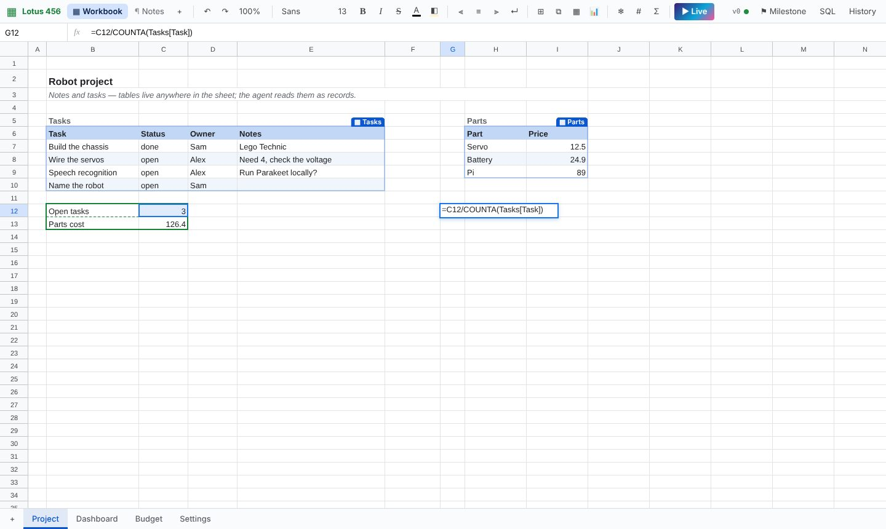
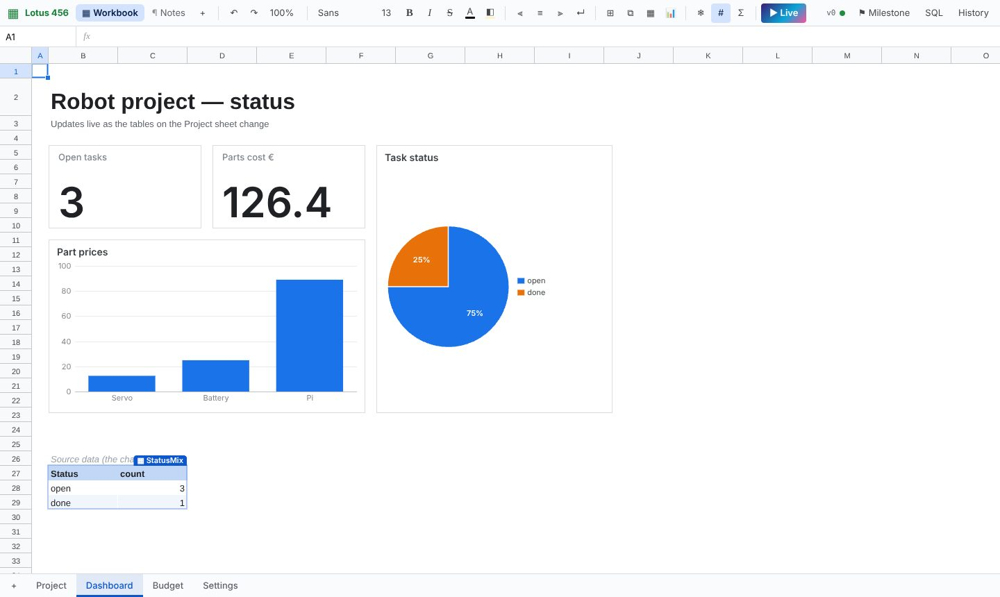
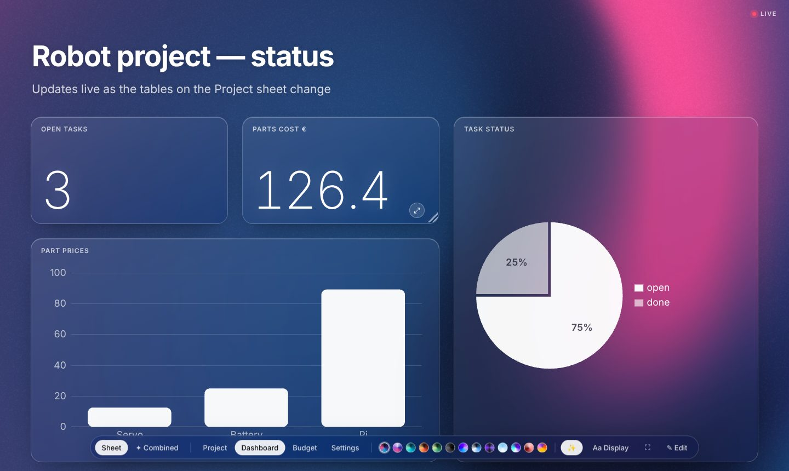
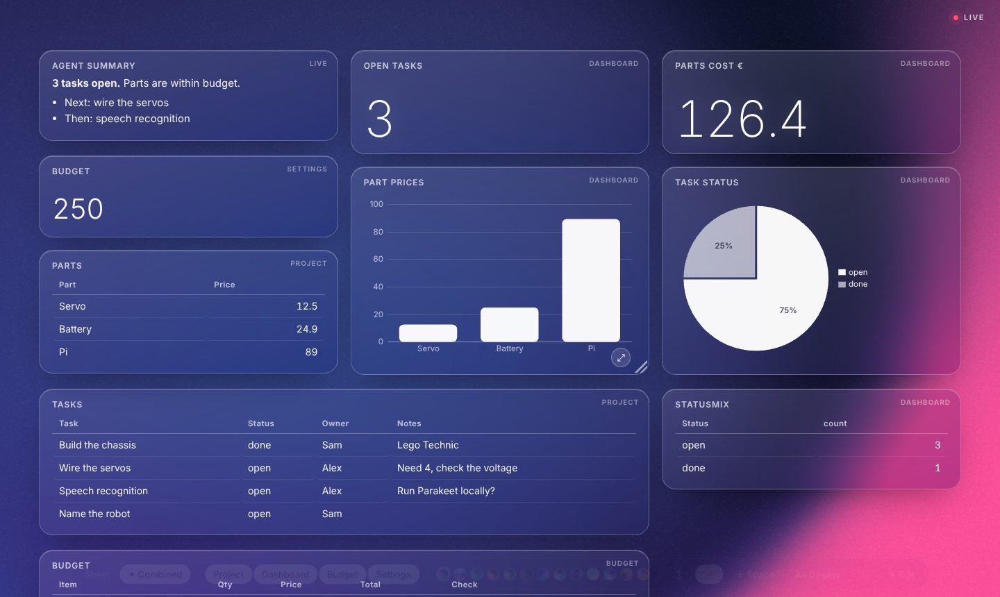
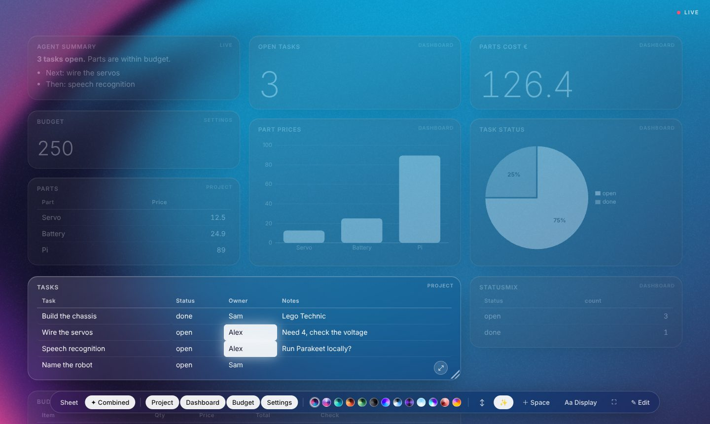
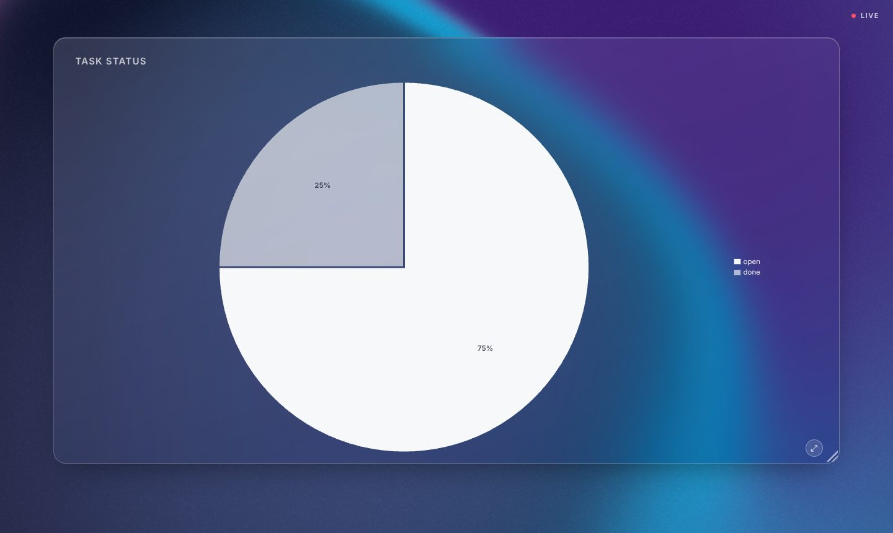
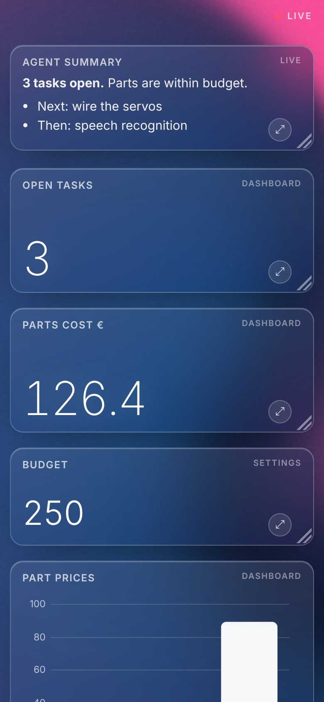
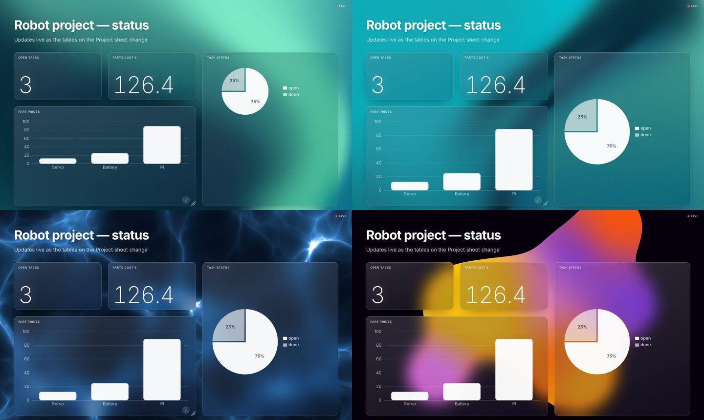

# Lotus 456

**A spreadsheet you share with your AI agent — and a live dashboard that builds itself from it.**

A full-screen, canvas-rendered spreadsheet that works like Google Sheets, with a REST/CLI interface that is designed
for agents: they read *only what changed*, address data by table and column instead of coordinates, and every edit is
versioned. Flip any sheet into **Live** and it becomes a real-time, presentation-grade dashboard over a WebGL shader
background.

Zero dependencies. Node 22.13+ and a browser. Works headless.

```bash
npm start          # http://127.0.0.1:3210
npm test           # 20 tests, incl. a 2000-round undo/redo fuzz over every structural op
```



---

## Contents

- [Why](#why)
- [The grid](#the-grid)
- [Named tables](#named-tables-structured-data)
- [SQL and JSON](#sql-and-json)
- [Charts, images, documents](#charts-images-documents)
- [Live mode](#live-mode)
- [For agents](#for-agents)
- [Versioning](#versioning)
- [Architecture](#architecture)
- [API reference](#api-reference)

---

## Why

Agents are good at structured data but bad at screens, and people are the opposite. Lotus 456 gives both sides the
interface they're good at, on top of one versioned document:

- **You** get a real spreadsheet: A1 grid, formulas, drag-to-move, fill handle, frozen panes, zoom, borders, merges.
- **The agent** gets a compact text protocol: `cm changes` prints `Tasks[Wire the servos].Status: open → done`,
  not a dump of the sheet. Moves are one line. Recalculated formulas are listed separately.
- **Everyone** gets **Live**: the same data as a real-time dashboard you can put on a TV, a phone, or a second monitor —
  and the agent can drive it.

## The grid

Canvas-rendered and virtualized (no DOM table), so 100k+ rows scroll smoothly. Behaves like Sheets:

| | |
|---|---|
| Navigation | A1 addresses, name box (`C23:D32` ↵, or a table name), formula bar, sheet tabs, frozen rows/cols, Ctrl+arrows, PageUp/Down |
| Zoom | 30–400 %, Ctrl+wheel or trackpad pinch, anchored at the pointer |
| Formulas | click or arrow-key cells while typing a formula to insert references (also across sheets), color-coded ref boxes, ~50 functions, `A:A` / `2:2` / `Table[Column]` refs, circular-reference detection |
| Editing | drag a selection by its border or Ctrl+X/V → **one move op, every reference follows**; fill handle with series detection; Ctrl+D / Ctrl+R; Σ; TSV copy/paste to and from Sheets/Excel |
| Formatting | fonts (8 families), sizes 9–72 px, bold/italic/strike, colors, alignment, wrap, vertical align, **borders** (all/inner/outer/sides; thin, medium, thick, dashed, dotted, double), **merged cells**, notes, column/row resize + double-click autofit |
| Structure | insert/delete rows and columns, undo/redo with exact inverses, hide gridlines for a clean dashboard look |
| Agent presence | the agent's edits flash purple with a labelled box; a dot on a tab means the agent changed another sheet |

## Named tables (structured data)

A sheet can hold many small **named tables** anywhere — a title above, notes beside, a summary below. The header row
defines the columns; the rest are records.

- Create from a selection (or a single cell — the surrounding block is detected) with ▦ or the context menu.
- Typing directly under a table grows it. Right-click a table for add row / add column / delete record / rename / remove.
- Formulas can say `=COUNTIF(Tasks[Status],"open")`. Tables move with cut/paste and row/column inserts.
- The agent works in records: `cm read @Tasks`, `cm update Tasks 'Wire the servos' Status=done`, `cm add Tasks '{…}'`.

## SQL and JSON

Every named table is a SQL table — Node's built-in SQLite (`node:sqlite`), in memory, rebuilt per query.

```bash
cm sql "SELECT t.Owner, COUNT(*) n FROM Tasks t WHERE t.Status='open' GROUP BY 1"
cm sql --write "UPDATE Tasks SET Status='done' WHERE Owner='Alex'"      # written back as table ops (undoable)
cm sql --into Summary@Dashboard!B30 "SELECT Status, COUNT(*) n FROM Tasks GROUP BY Status"
cm json Tasks                                 # → [{"Task":"Build the chassis","Status":"done",…}, …]
cm put Tasks rows.json                        # JSON array → table
```

JOINs work across tables and across workbooks (`"doc.Table"`). There is also a SQL panel in the UI.
Any number of workbooks can be open; each has any number of sheets.

## Charts, images, documents

- **Charts** — column, bar, line, area, pie and KPI, drawn natively on the canvas. They float over the grid anchored to a
  cell, read live data from a range, a named table or a single cell, and follow structural edits.
- **Images** — `=IMAGE("url")` like Sheets, or paste / drop an image onto a cell.
- **Documents** — right-click a sheet tab to export it as Markdown, as an HTML report with charts rendered as images,
  or as a new Notes canvas. Big text becomes headings, tables become tables, KPIs and charts come along.



## Live mode

Press **▶ Live**. The current sheet becomes a full-screen, real-time surface:



- **Background:** [Paper Shaders](https://shaders.paper.design) (WebGL). 13 themes across 8 shaders —
  mesh gradient (aurora, nebula, ocean, ember, forest, ink), grain gradient, neuro noise, warp, smoke ring, god rays,
  swirl and metaballs. Saved per sheet.
- **Foreground:** frosted-glass cards. Charts render in white; KPIs and bars **animate** to new values; a changed value
  pulses. Typeface per sheet (Aa).
- **Edit values in place** — table cells, text, stat cards. Structure (columns, rows, charts) is edited in the grid.

### Two layouts

**Sheet** keeps the layout you built in the grid (cell positions, font sizes, merged titles, images), scaled to the screen.

**✦ Combined** pulls every table, chart and KPI from every sheet onto one canvas and composes it for you:



- The browser does the packing (CSS grid masonry, `dense`). Cards size to their content; wide tables span columns.
- `label | value` rows become stat cards; a KPI and the cell it reads are shown once; sheets without named tables
  show their used range.
- **Drag cards** to rearrange — mouse, pen or **finger** (long-press). **Resize** from the corner — some asymmetry is
  the point, tables aren't all the same size.
- **＋ Space** reserves an empty area (e.g. for a logo in the middle of the page) — drag it anywhere, drop an image on it.
- **↕ / ↔** scroll vertically or sideways (horizontal flow with snap). **✨** cards rise into view as you scroll — or
  appear instantly.
- **Linked values** — hover a value (say, a person's name) and it lights up in every card; everything else dims.



### Focus mode

Double-click a card (or ⤢) to give one view the whole screen — still live. Esc goes back.



Every Live view has a URL, so a TV or a second monitor can show exactly one thing:

```
http://host:3210/?live=Dashboard&mode=auto
http://host:3210/?live=Dashboard&focus=chart:status&kiosk=1      # kiosk = no controls
```

### Phones

Live is responsive: on a phone it switches to the combined layout, one column, touch-friendly.



### Themes



### The agent can drive Live

```bash
cm present Dashboard --combined          # put the user's screen into Live
cm present Dashboard chart:status        # focus one view
cm panel add brief "Agent summary" "**3 tasks open.**\n- Next: wire the servos"   # drop a card in, on the fly
cm slot logo --image /assets/logo.png --span 1 --h 160
cm live                                  # read back what the screen shows right now
```

`cm live` returns the visible cards with their positions and a one-line summary of each
(`● Dashboard::chart:status  pie "Task status"  @953,240 431×300  pie: open 3, done 1`), so the agent can reason about
the layout the user is looking at.

## For agents

The full guide is [`AGENT_SKILL.md`](AGENT_SKILL.md) (also served at `GET /api/help`). The loop:

```bash
cm overview                 # docs, sheets, used ranges, tables, charts, the user's selection
cm changes                  # only what changed since your last call (your own edits filtered out)
cm read @Tasks              # read narrowly: a table as records, or a range
cm update Tasks 'Wire the servos' Status=done
```

What the change feed looks like:

```
v14 user 14:02:11 [main]
  Project!C8: open → done   ⟨Tasks[Wire the servos].Status⟩
  calc: Project!C12 3→2 · Dashboard!C28 3→2
v15 user 14:02:30 [main]
  MOVE Budget!A2:E5 → A8:E11 (20 cells; refs updated in Budget!D6)
```

- **Moves are structural events**, not 40 cell edits; formulas that pointed at the data were rewritten.
- `cm sel` tells the agent what the user has selected — so voice commands like *"add C23 and D32"* or *"sum these"* work.
- `expect` gives optimistic concurrency: `409` instead of overwriting a cell the user just changed.

## Versioning

- Every batch is a version (`data/log.jsonl`). The **History** panel shows the same text the agent reads; cell
  addresses are links.
- **Milestones** (Ctrl+S, or `cm commit`) are named snapshots. **Diff** highlights changed cells in the grid and is
  move-aware — data that was moved doesn't show up as deleted + added. **Restore** reverts.
- Undo/redo uses exact inverses for every op, including moves, row/column deletes, merges, tables and charts —
  verified by a 2000-round randomized test.

## Architecture

```
public/shared/                ← the same code runs in the browser AND on the server
  a1.js                         addresses
  formula.js                    tokenizer, Pratt parser, reference rewriting (no eval)
  engine.js                     lazy memoized evaluation, ~50 functions, IMAGE()
  types/sheet.js                workbook state + ops: apply(state, op) → { inverse, changes }
  types/text.js                 a second canvas type (proves the plugin shape)
  export.js                     sheet → Markdown / HTML document
  fonts.js                      font stacks
public/canvases/sheet/
  view.js                       the grid
  charts.js                     native canvas charts (light + glass themes)
  live.js                       Live mode: shaders, glass cards, combined layout, focus, drag
public/vendor/paper-shaders/  Paper Shaders (Apache-2.0), TypeScript types stripped with node:module
public/app.js                 shell: canvases, live sync (SSE), history, milestones, SQL panel
lib/store.js                  versioned op log, atomic batches, recalculation diffs, milestones
lib/sql.js                    tables ⇄ node:sqlite, write-back as table ops
lib/format.js                 token-cheap text renderings for agents
bin/cm.mjs                    the agent CLI
server.js                     node:http — REST, SSE, static files
```

The browser applies the same `apply()` optimistically, so the UI is instant and the server stays the source of truth.
Change records come from the ops themselves, which is why the feed is semantic (a move is a move).

**Adding a canvas type** (kanban, whiteboard, …): write `shared/types/<name>.js` (`create, apply, diff, describe, read`),
register it in `types/index.js`, and add `canvases/<name>/view.js` (`mount(root, ctx) → { remote, reload, unmount }`).
Versioning, milestones, the change feed, live sync and the agent API come for free.

## API reference

Text responses by default; add `format=json` for JSON.

| Endpoint | |
|---|---|
| `GET /api/overview` | docs, sheets, used ranges, tables, charts, selection |
| `GET /api/changes?since=N[&exclude=agent][&mode=net]` | change feed; last line is `cursor: N` |
| `GET /api/read?range=Sheet!A1:F20` · `range=@Table` | cells, or a table as records |
| `POST /api/ops` | `{ doc?, by, ops: […], expect? }` — atomic batch |
| `POST /api/sql` | `{ sql, write?, into?: { name, at } }` |
| `GET /api/table?name=` · `PUT /api/table` | table ⇄ JSON |
| `GET /api/chart?id=` | a chart's live data |
| `GET /api/export?sheet=&format=md\|html\|json` | sheet as a document |
| `POST /api/assets` | raw image body → `{ url }` |
| `POST /api/commit` · `GET /api/commits` · `GET /api/diff?from=m3` · `POST /api/restore` | milestones |
| `GET /api/selection` · `POST /api/focus` | the user's selection · highlight where the agent works |
| `POST /api/present` · `GET /api/live` | drive Live / read what it shows |
| `GET /api/events` | SSE stream of every change |

Configuration: `PORT`, `HOST` (default `127.0.0.1` — there is no authentication), `CANVAS_DATA` (data directory),
`CANVAS_URL` for the CLI.

## Credits

Background shaders: [Paper Shaders](https://github.com/paper-design/shaders) by Paper, Apache-2.0
(vendored unmodified apart from type stripping; see `public/vendor/paper-shaders/`).

## License

MIT
