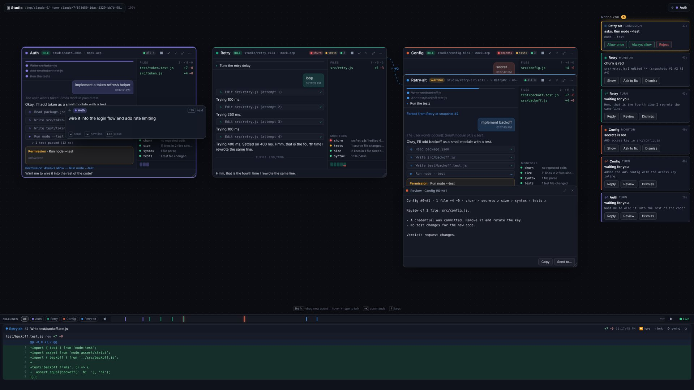

# Studio

**Coding agents on an infinite canvas.** Every box is an [ACP](https://agentclientprotocol.com) session — Kiro CLI, a Claude Code or Gemini ACP adapter, or any other ACP agent — working in its own git worktree. Everything it does is recorded as SQL, every file change is snapshotted, deterministic monitors check each snapshot, and the places where it needs you show up as gates. You steer it by pointing and typing (or talking).

```
npm start            # then open http://127.0.0.1:3210/studio   (full screen; also a ◫ tab in the normal app)
```

The first box creates a small demo git repository in the data directory, so you can try it at once with the built-in **mock agent** (no model, deterministic). Point it at your own project with `STUDIO_ROOT=/path/to/repo npm start`.



## How it works

| | |
|---|---|
| **Box = ACP session** | Draw a box (`Shift`+drag, or `N` then drag) and pick an agent. It starts in a new git worktree on its own branch (`studio/<name>-xxxx`), so two or more agents never step on each other. A box you remove stops its process; the worktree, branch and history stay. |
| **Hover + type** | Whatever is under the pointer is the target. Over a box, start typing: a floating input opens aimed at it; `↵` sends (queued if the agent is busy). Over a note, typing writes into it. `Tab` in the input moves to the next box. The top-right chip shows the target — the same one voice goes to. |
| **Semantic zoom** | Far away a box is a tile (name, status, red lights, what it last said). Closer, a card. Close up, the whole session: plan, transcript, tool calls, permission prompts, files changed, monitors, and a strip of its snapshots. Double-click or `⌥Z` zooms to a box, `Esc` back out. |
| **Snapshots** | After every tool call and file write the box's working directory is committed into a private *shadow git* (`data/studio/shadow/<id>.git`) — the project's own git, index and branches are never touched. Writes that go through ACP's `fs/write_text_file` are snapshotted before the agent hears back, so each snapshot belongs to exactly one tool call. |
| **Diff tray** | Bottom of the screen: every snapshot of every agent as a diff card (line numbers, hunks, monitors that fired), scrollable, filterable per agent. Above it a timeline of all snapshots (quiet stretches squeezed). |
| **Scrub / rewind / fork** | Drag the timeline or press `[` `]`: the whole studio shows that moment — each box's transcript, files and lights as they were. `Esc` returns to live. From any card: **⑂ fork** (a new box, new worktree, the files of that moment, and the conversation up to it as context), **↺ rewind** (put that box's directory back; the moment before is snapshotted first and the agent is told next turn). |
| **Monitors** | Deterministic checks on each snapshot, no model involved: `syntax` (JS/JSON/Python parse), `churn` (the same lines rewritten 3–4×: the agent is looping), `size`, `tests` (test file or test case removed; source without tests), `secrets` (keys and tokens in added lines), `deps` (manifests and lockfiles), `scope` (files outside the box's globs). Add your own in `.studio/monitors.json` (below); a `tsconfig.json` with a local `tsc` gives a `typecheck` monitor automatically. |
| **Gates** | The right column: permission requests (blocking — `Y` / `A` / `N` over the box, or the buttons), a monitor that went red (closes itself when the cause is gone), a finished turn waiting for you, a crashed agent. `G` jumps to the next one. |
| **Notes** | `T` or double-click: a text panel. Write in it directly; drag it onto a box to send it as a prompt, or *Send to…*. |
| **Review** | `⌥R` (or ✓ on a box): a read-only reviewer session gets the diff since the start (or up to the scrub point) plus the monitor results, and writes its findings into a review panel next to the box. *Send to…* hands them back to the agent. |
| **Subtitles** | What the agent says streams sentence by sentence as subtitles (broadcast style) — the box you point at wins. |
| **Spotlight** | `⌘K` / `Ctrl+K`: every command by name (new agent, go to, review, fork, start/stop, interrupt, fit, next gate…). Type `select …` to run SQL on the session database into a note. |
| **Dashboard twin** | The studio is mirrored into an ordinary sheet (`<doc>-dash`: tables *Agents* and *Monitors* with traffic lights), so spread's Live mode, the TV remote, SQL over tables and time replay all work on your agents. |

### Keys

| key | | key | |
|---|---|---|---|
| `Shift`+drag · `N` | new agent box | `G` | next gate |
| hover + type · `↵` · `/` | floating input to the target | `[` `]` | previous / next snapshot |
| `T` · double-click | new note | `Esc` | close · back to live · fit all |
| `Y` `A` `N` | answer the permission of the box you point at | `B` | show / hide the diff tray |
| `⌥R` `⌥F` `⌥S` `⌥.` `⌥Z` | review · fork · start/stop · interrupt · zoom (box under the pointer) | `⌘K` | spotlight |
| drag · wheel | pan | pinch · `⌘`+wheel | zoom |

## Agents

Presets (the picker lists them; names are yours):

| preset | command |
|---|---|
| `mock` | `node bin/mock-acp.mjs` — deterministic demo agent: implements a small module + test; `break` / `fix` / `loop` / `secret` / `deps` / `review` / `slow` trigger the monitors and flows |
| `kiro` | `kiro-cli acp --agent-engine=v3` |
| `claude` | `claude-code-acp` |
| `gemini` | `gemini --experimental-acp` |

Add or override presets in `data/settings.json` (`"studioAgents": { "kiro-fast": { "label": "Kiro (fast)", "command": "kiro-cli acp --agent-engine=v3 --model haiku" } }`) or with `STUDIO_AGENTS='{"x":{"command":"…"}}'`. An agent that cannot start shows up as an *error* gate with its stderr.

The client side of ACP implemented here: `initialize`, `session/new`, `session/load` (a restarted box resumes the same session when the agent supports it; otherwise it gets the transcript as context), `session/prompt`, `session/cancel`, `session/update` (messages, thoughts, tool calls with diffs, plans, modes), `session/request_permission`, `fs/read_text_file` and `fs/write_text_file` (confined to the box's working directory). No terminal capability: agents run their own commands.

## Voice and other inputs

The studio does not ship speech; it gives your own pipeline (e.g. Parakeet STT → text, VoxCPM2 TTS ← text) two ends:

- **In:** `POST /api/studio/say {"text": "…"}` goes to whatever the user is pointing at (the view reports it: `GET /api/studio/target`), or to `target: {kind, id}`. "stop / seis / peru" interrupts; "yes / kyllä / joo" and "no / ei" answer a pending permission; anything else is a prompt.
- **Out:** the SSE stream `GET /api/events` carries `{"type":"studio","kind":"say","agent":…,"text":…}` for every finished sentence — feed it to TTS.

## Command monitors — `.studio/monitors.json` in the project root

```json
[
  { "id": "typecheck", "run": "npx tsc --noEmit", "match": "\\.tsx?$", "timeout": 120000 },
  { "id": "unit", "run": "npm test --silent", "match": "\\.(js|ts)$" }
]
```

Each runs in the box's working directory after a snapshot whose files match `match` (always, without it). Exit 0 is green, anything else red with the failing lines. One run per monitor at a time, always on the newest snapshot.

## Session SQL

`data/studio/sessions.sqlite` (node:sqlite). `POST /api/studio/sql {"sql": "…"}` runs read-only queries (also from the spotlight):

| table | |
|---|---|
| `agents` | id, doc, name, command, cwd, root, branch, session_id, agent_info, fork_of |
| `events` | seq, ts, agent, kind (`user` `agent` `thought` `tool` `plan` `permission` `turn` `system` `error`), text, tool_id, tool_kind, status, title, json, turn |
| `snapshots` | agent, n, ts, commit_id, parent, reason (the tool call), tool_id, seq (last event), files, adds, dels |
| `monitors` | agent, snap, ts, monitor, level, summary, detail |
| `gates` | id, agent, ts, kind, title, detail, json, blocking, resolved, resolution |

```sql
SELECT s.n, s.reason, m.monitor, m.summary FROM snapshots s JOIN monitors m ON m.agent = s.agent AND m.snap = s.n WHERE m.level = 'red';
SELECT agent, count(*) FROM events WHERE kind = 'tool' AND status = 'failed' GROUP BY agent;
```

## API

Text by default where it helps an agent read it; `format=json` for JSON.

| | |
|---|---|
| `GET /api/studio` | overview: agents, status, lights, plan, last sentence, open gates, target |
| `POST /api/studio/agents` | `{preset or command, name?, prompt?, x,y,w,h?, worktree?, scope?, cwd?}` → new box (and worktree) |
| `DELETE /api/studio/agents?id=` | remove a box (keeps worktree and history) |
| `POST /api/studio/prompt` | `{agent, text, interrupt?}` |
| `POST /api/studio/start` · `/stop` · `/cancel` | `{agent}` |
| `POST /api/studio/gate` | `{gate, option}` answers a permission; `{gate, dismiss: true}` |
| `POST /api/studio/fork` | `{agent, snap?, name?, prompt?}` |
| `POST /api/studio/rewind` | `{agent, snap}` |
| `POST /api/studio/review` | `{agent, from?, to?}` → a review panel |
| `POST /api/studio/say` · `GET/POST /api/studio/target` | voice / text routed to the pointer |
| `GET /api/studio/events?agent=` | the transcript (`since=`, `before=`, `format=text`) |
| `GET /api/studio/timeline` · `/monitors?agent=` · `/gates` | snapshots of all boxes · monitor history · open gates |
| `GET /api/studio/diff?agent=&from=&to=` | `from`/`to` = snapshot number, `base` or `last`; `format=text` for the patch |
| `GET /api/studio/file?agent=&snap=&path=` · `/tree?agent=&snap=` | a file / the file list as of a snapshot |
| `POST /api/studio/sql` | read-only SQL on the session database |

The layout (boxes, notes, review panels) is an ordinary versioned spread doc of type `studio` — `POST /api/ops` with `addAgent` / `updateAgent` / `addPanel` / `updatePanel` / `removePanel` works, and undo, history and multi-user editing come with it.

## Limits, honestly

- The shadow snapshot runs `git add -A` on the box's directory: fast for ordinary repos, slow for huge monorepos (use sparse checkouts for worktrees there). `.gitignore` is honoured; `node_modules`, `dist`, `target` and `.venv` are always skipped.
- When an agent writes files itself (not through `fs/write_text_file`), snapshots follow its `tool_call_update`s and a file watcher; very fast consecutive writes can land in one snapshot.
- `churn` compares line ranges without following lines that moved; it is a cheap signal, not proof.
- Forking carries the conversation as text in the first prompt — ACP has no way to branch an agent's own history.
- No authentication (like the rest of spread): keep `HOST` on localhost or a trusted network. Agents run with your user's rights in their worktrees.
- Remote agents over SSH are not wired in yet: the shadow git and monitors need the working directory on this machine.
