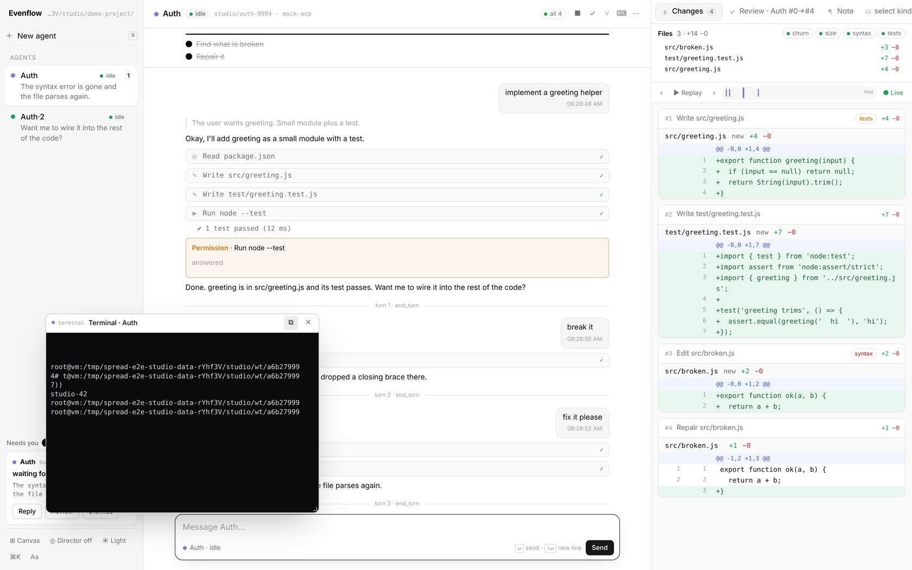

# Evenflow documentation

Evenflow is a workspace for coding agents. Every agent is an [ACP](https://agentclientprotocol.com) session (Kiro CLI, a Claude Code or Gemini ACP adapter, or any other ACP agent) working in its own git worktree. You see them all at once on an infinite canvas, or one at a time in a classic coding layout. Everything an agent does is recorded, every file change is a snapshot you can replay, rewind or fork from, and deterministic monitors check each step.



## Read in this order

| | |
|---|---|
| **[Getting started](getting-started.md)** | Install, run, the first agent, your own repository, real agents |
| **[Concepts](concepts.md)** | The few ideas everything else is built from: boxes, worktrees, sessions, turns, snapshots, monitors, gates, panels, the director |
| **[Using Evenflow](guide.md)** | The screen: canvas mode and focus mode, floating panels, talking to agents, panels, layouts, keys |
| **[History: snapshots, rewind, fork](history.md)** | The timeline, replay, rewinding a turn (conversation, files or both), forking |
| **[Agents](agents.md)** | Presets and configuration, what of ACP is supported, the tools every agent gets (MCP), the mock agent |
| **[Monitors and gates](monitors.md)** | The built-in checks, your own command monitors, where agents need you |
| **[The director](director.md)** | Who runs the screen: you, built-in rules, or a director agent |
| **[Remote and voice](remote-and-voice.md)** | Agents on a Linux box, the screen on your Mac; plugging in speech |
| **[HTTP API](api.md)** | Every endpoint, the event stream, the view command, the session database |
| **[Architecture](architecture.md)** | How it is built: modules, storage, what happens on a prompt |
| **[Development](development.md)** | Tests, the browser test, screenshots, conventions |
| **[Limits](limits.md)** | What it does not do (yet), honestly |

Evenflow runs on **Spread**, a canvas engine with versioned documents and spreadsheets. The studio's layout is a Spread document, and its agents are mirrored into a Spread sheet. Spread's own manual is [SPREAD.md](SPREAD.md).

## In one minute

```
npm start                                  # → http://127.0.0.1:3210/studio
STUDIO_ROOT=/path/to/your/repo npm start   # work on your own repository
```

Draw a box (`Shift`+drag) and pick an agent. Point at the box and type to give it a task, or press `⌘\` for focus mode and use the composer. Changes show up as diffs on the right (focus mode) or at the bottom (canvas). Press ⟲ next to a prompt to take the conversation back to before it, with or without the files.
