> This is the README of **Spread**, the versioned canvas engine Evenflow is built on (sheets, Live dashboards, history, SQL). Evenflow itself: [../README.md](../README.md).

# Spread

**A spreadsheet you share with your AI agent — and a live dashboard that builds itself from it.**

A full-screen, canvas-rendered spreadsheet that works like Google Sheets, with a REST/CLI interface that is designed
for agents: they read *only what changed*, address data by table and column instead of coordinates, and every edit is
versioned. Flip any sheet into **Live** and it becomes a real-time, presentation-grade dashboard over a WebGL shader
background.

Zero dependencies (two libraries vendored: shaders and maps). Node 22.13+ and a browser. Works headless.

```bash
npm start          # http://127.0.0.1:3210
npm test           # 62 tests: engine, API, CLI, MCP, maps, feeds, the race simulator, replay, the demo tour, a 2000-round undo/redo fuzz over every op
npm run e2e        # 29 browser tests (Playwright): two users, Live, slides, traffic lights, effects, visuals, maps, replay, the Pitwall, table tools, remote, phone, XSS
```

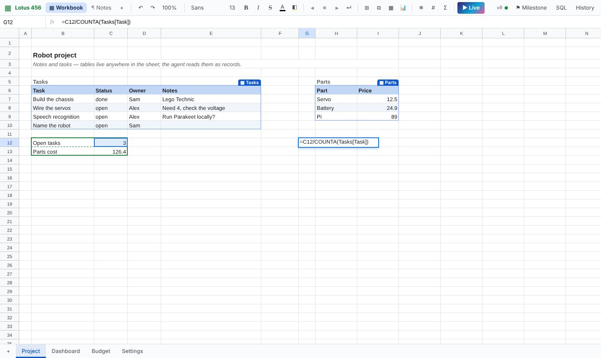

---

## Contents

- [Why](#why)
- [Studio: coding agents](#studio-coding-agents-on-a-canvas) · [STUDIO.md](../STUDIO.md)
- [The grid](#the-grid)
- [Named tables](#named-tables-structured-data)
- [Traffic lights](#traffic-lights)
- [SVG visuals](#svg-visuals)
- [SQL and JSON](#sql-and-json)
- [Charts, images, documents](#charts-images-documents)
- [Live mode](#live-mode) · [Race weekend](#race-weekend-pitwall) · [Maps](#maps) · [Open data from Finland](#open-data-from-finland) · [Time replay](#time-replay)
- [Slides](#slides)
- [Multi-user and history](#multi-user-and-history)
- [Remote control](#remote-control)
- [For agents](#for-agents) · [MCP](#mcp-server) · [Guided demo](#guided-demo)
- [Versioning](#versioning)
- [Architecture](#architecture)
- [API reference](#api-reference)
- [Roadmap](#roadmap)

---

## Why

Agents are good at structured data but bad at screens, and people are the opposite. Spread gives both sides the
interface they're good at, on top of one versioned document:

- **You** get a real spreadsheet: A1 grid, formulas, drag-to-move, fill handle, frozen panes, zoom, borders, merges.
- **The agent** gets a compact text protocol: `cm changes` prints `Tasks[Wire the servos].Status: open → done`,
  not a dump of the sheet. Moves are one line. Recalculated formulas are listed separately.
- **Everyone** gets **Live**: the same data as a real-time dashboard you can put on a TV, a phone, or a second monitor —
  and the agent can drive it.

## Studio: coding agents on a canvas

[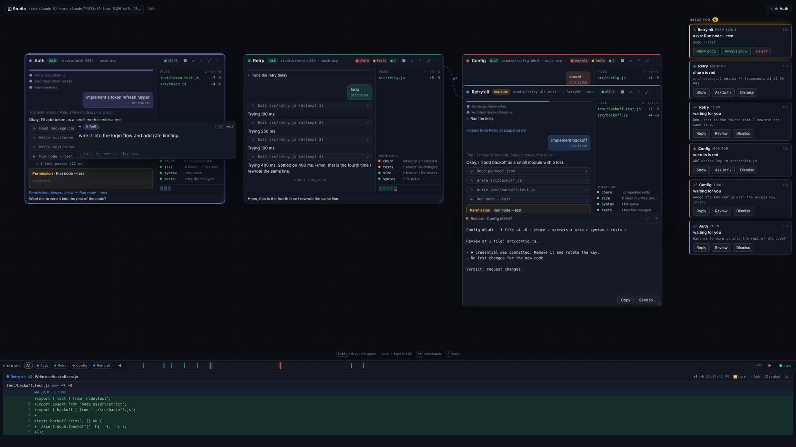](../STUDIO.md)

`/studio` is a full-screen canvas for coding agents, in light and dark. Draw a box and an [ACP](https://agentclientprotocol.com) agent (Kiro CLI, a Claude Code or Gemini ACP adapter, or the built-in mock) starts in its own git worktree — or a sparse slice of a monorepo. Point at a box and type (or talk) to steer it; agents get tools of their own to spin off a copy, start a reviewer, or put a preview on the screen. Every step is SQL, every file change a snapshot in a shadow git, checked by deterministic monitors; where an agent needs you shows up as a gate. All diffs scroll at the bottom on one timeline you can replay, rewind or fork from. Real terminals, live previews (dev servers, voxl desktops), code maps, notes and snippets sit on the same canvas; idle, it turns into a shader screensaver of the agents at work. Run it on a Linux box and look at it from your Mac with `node bin/remote.mjs me@box`. → **[STUDIO.md](../STUDIO.md)**

## The grid

Canvas-rendered and virtualized (no DOM table), so 100k+ rows scroll smoothly. Behaves like Sheets:

| | |
|---|---|
| Navigation | A1 addresses, name box (`C23:D32` ↵, or a table name), formula bar, sheet tabs, frozen rows/cols, Ctrl+arrows, PageUp/Down |
| Zoom | 30–400 %, Ctrl+wheel or trackpad pinch, anchored at the pointer |
| Formulas | click or arrow-key cells while typing a formula to insert references (also across sheets), color-coded ref boxes, ~50 functions, `A:A` / `2:2` / `Table[Column]` refs, circular-reference detection |
| Editing | drag a selection by its border or Ctrl+X/V → **one move op, every reference follows**; fill handle with series detection; Ctrl+D / Ctrl+R; Σ; TSV copy/paste to and from Sheets/Excel |
| Formatting | fonts (8 families), sizes 9–72 px, bold/italic/strike, colors, alignment, wrap, vertical align, **borders** (all/inner/outer/sides; thin, medium, thick, dashed, dotted, double), **merged cells**, notes, column/row resize + double-click autofit |
| Structure | insert/delete rows and columns, undo/redo with exact inverses, hide gridlines for a clean dashboard look |
| Agent presence | the agent's edits flash purple with a labelled box; a dot on a tab means the agent changed another sheet |
| Tables | drag a table by its **name chip** to move it (refs follow); **drop it on a sheet tab** to move it to that sheet (it lands in free space); **＋** handles under and beside the table you're in add a row or a column; right-click → *move to sheet …* |

## Named tables (structured data)

A sheet can hold many small **named tables** anywhere — a title above, notes beside, a summary below. The header row
defines the columns; the rest are records.

- Create from a selection (or a single cell — the surrounding block is detected) with ▦ or the context menu.
- Typing directly under a table grows it. Right-click a table for add row / add column / delete record / rename / remove.
- Formulas can say `=COUNTIF(Tasks[Status],"open")`. Tables move with cut/paste and row/column inserts.
- The agent works in records: `cm read @Tasks`, `cm update Tasks 'Wire the servos' Status=done`, `cm add Tasks '{…}'`.

## Traffic lights

Color cells by their value — 🚦 in the toolbar or right-click → *Traffic lights…* (conditional formatting).

- Rules: `<` `≤` `>` `≥` `=` `≠` *between* *contains* *empty* *not empty*; the first matching rule wins. Thresholds can
  be formulas (`=Settings!B1`), so a budget cell can move the line.
- The editor guesses a starting set from the data: numbers get green / amber / red thresholds, words like
  *done / open / late* get their obvious colors.
- Lights follow their cells through moves, row/column inserts and deletes, and moves to another sheet — like
  tables do. Undo is exact.
- In Live, lit table cells get a colored glow, and a KPI whose source cell is lit gets a pulsing status light. When the
  value crosses a threshold the color cross-fades.
- Agent: `cm traffic Budget!D2:D5 '<20:green' 'between 20 60:amber' '>60:red'` (`':#hex'` for any color; `off` removes).

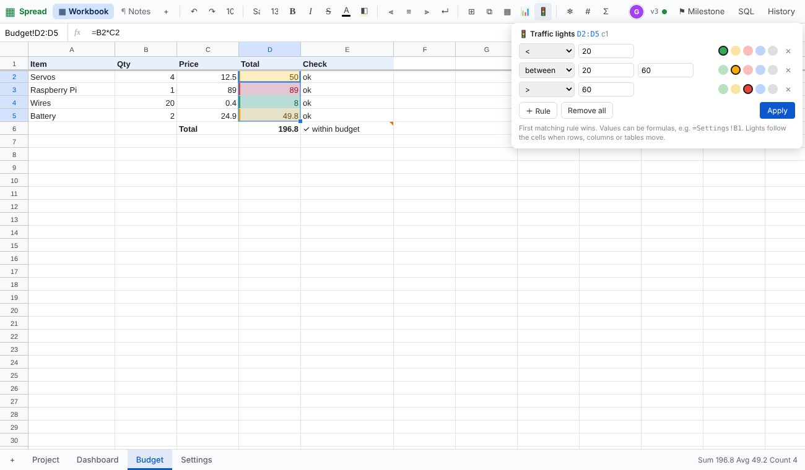
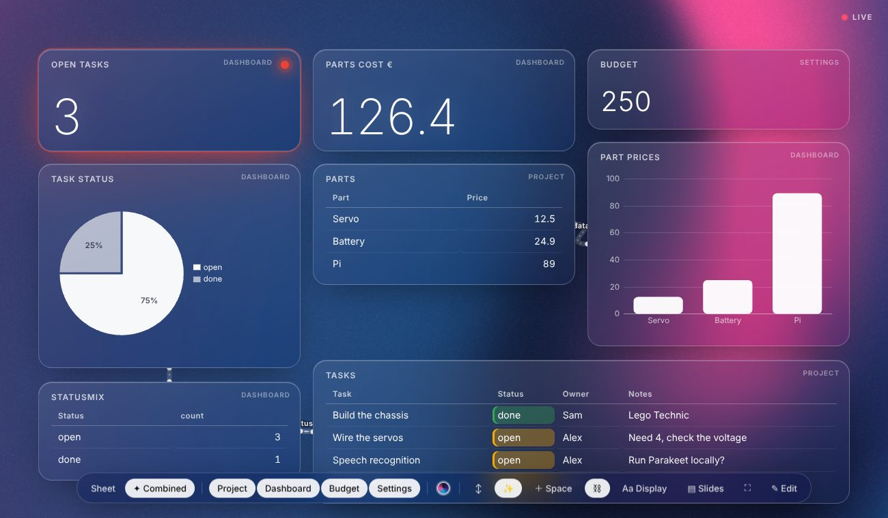

## SVG visuals

Show a value as a picture: a lamp, a switch, a gauge, a battery, a progress ring, a traffic light, a status icon,
the weather — or anything a model draws for you. 🎨 in the toolbar.

- **Three kinds, one standard** — [`spread-viz/1`](VIZ_SPEC.md): `toggle` (on/off), `range` (0–100, or any
  min–max) and `states` (2–12 named pictures picked by rules like the traffic lights'). A pack is one JSON file with
  SVG inside: CSS variables (`--v`, `--pct`), `data-state` / `data-level` and `{{value}}` placeholders do the rest.
- **Anywhere**: `=VIZ("status", C7)` in a cell (the cell keeps its value for sorting, formulas and SQL; put it in a
  table column for a status column), or a visual card (🎨 → *Card*, `cm viz card gauge Budget!D6 --at K2`).
- **In Live** numbers glide (the needle turns, the battery fills), states cross-fade, and the card can be a small tile.
- **Made by models**: 🎨 → *Copy a prompt for a model* gives any LLM the spec; paste its JSON back in (code
  fences are fine). Every problem is listed — no viewBox, a `<script>`, an external link — so the model can fix it.
  Agents: `cm viz spec`, `cm viz check pack.json`, `cm viz add pack.json`.
- **Safe by construction**: packs are checked on install and *sanitized again when drawn* (allowlist of SVG elements
  and attributes, no scripts, events, foreign objects, external URLs or `@import`). Each visual lives in its own
  shadow root, so a pack's styles can't touch the page; the grid draws them as images.

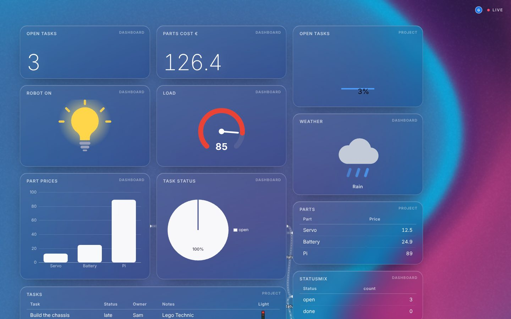


## SQL and JSON

Every named table is a SQL table — Node's built-in SQLite (`node:sqlite`), in memory, rebuilt per query.

```bash
cm sql "SELECT t.Owner, COUNT(*) n FROM Tasks t WHERE t.Status='open' GROUP BY 1"
cm sql --write "UPDATE Tasks SET Status='done' WHERE Owner='Alex'"      # written back as table ops (undoable)
cm sql --into Summary@Dashboard!B30 "SELECT Status, COUNT(*) n FROM Tasks GROUP BY Status"
cm json Tasks                                 # → [{"Task":"Build the chassis","Status":"done",…}, …]
cm put Tasks rows.json                        # JSON array → table
```

JOINs work across tables and across workbooks (`"doc.Table"`). There is also a SQL panel in the UI.
Any number of workbooks can be open; each has any number of sheets.

## Charts, images, documents

- **Charts** — column, bar, line, area, pie and KPI, drawn natively on the canvas. They float over the grid anchored to a
  cell, read live data from a range, a named table or a single cell, and follow structural edits.
- **Images** — `=IMAGE("url")` like Sheets, or paste / drop an image onto a cell.
- **Documents** — right-click a sheet tab to export it as Markdown, as an HTML report with charts rendered as images,
  or as a new Notes canvas. Big text becomes headings, tables become tables, KPIs and charts come along.

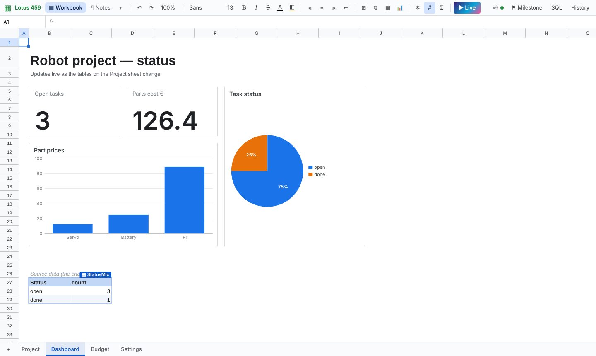

## Live mode

Press **▶ Live**. The current sheet becomes a full-screen, real-time surface:

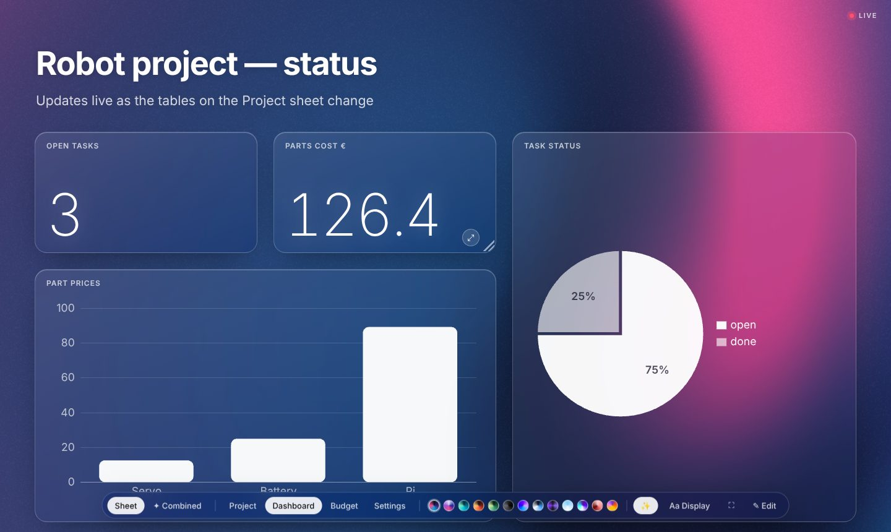

- **Background:** [Paper Shaders](https://shaders.paper.design) (WebGL). 13 themes across 8 shaders —
  mesh gradient (aurora, nebula, ocean, ember, forest, ink), grain gradient, neuro noise, warp, smoke ring, god rays,
  swirl and metaballs. Saved per sheet.
- **Foreground:** frosted-glass cards. Charts render in white; KPIs and bars **animate** to new values; a changed value
  pulses. Typeface per sheet (Aa).
- **Edit values in place** — table cells, text, stat cards. Structure (columns, rows, charts) is edited in the grid.

### Two layouts

**Sheet** keeps the layout you built in the grid (cell positions, font sizes, merged titles, images), scaled to the screen.

**✦ Combined** pulls every table, chart and KPI from every sheet onto one canvas and composes it for you:

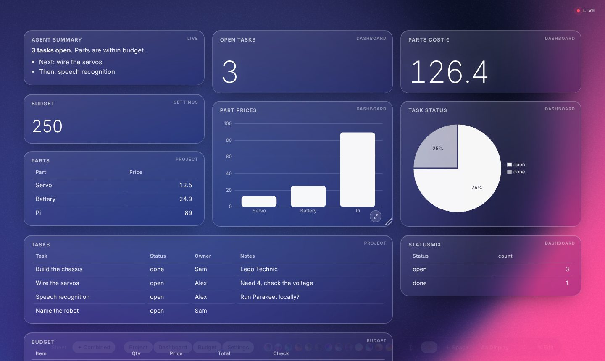

- The browser does the packing (CSS grid masonry, `dense`). Cards size to their content; wide tables span columns.
- `label | value` rows become stat cards; a KPI and the cell it reads are shown once; sheets without named tables
  show their used range.
- **Drag cards** to rearrange — mouse, pen or **finger** (long-press). **Resize** from the corner — some asymmetry is
  the point, tables aren't all the same size.
- **＋ Space** reserves an empty area (e.g. for a logo in the middle of the page) — drag it anywhere, drop an image on it.
- **↕ / ↔** scroll vertically or sideways (horizontal flow with snap). **✨** cards rise into view as you scroll — or
  appear instantly.
- **Linked values** — hover a value (say, a person's name) and it lights up in every card; everything else dims.

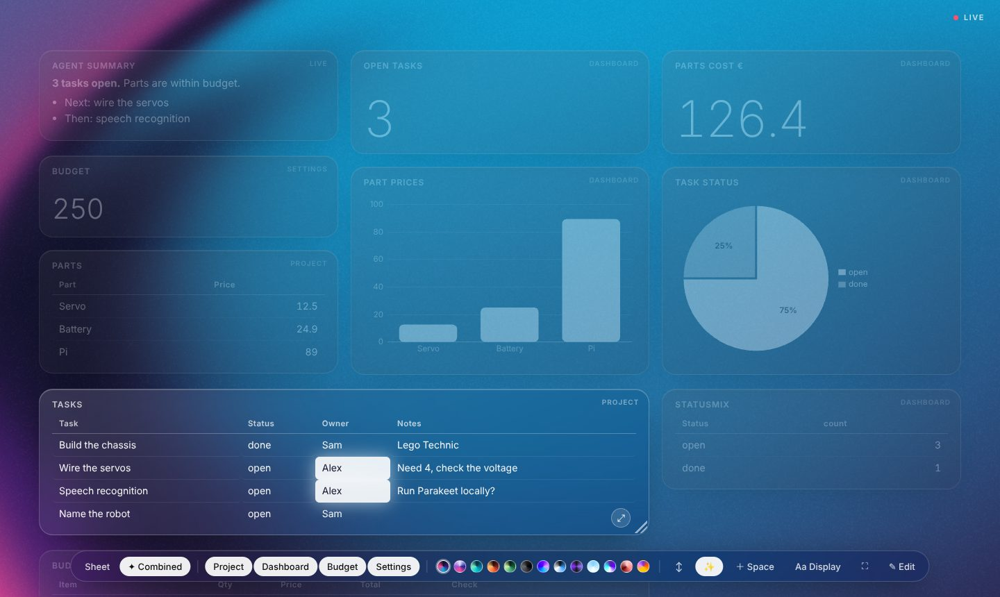

### Focus mode

Double-click a card (or ⤢) to give one view the whole screen — still live. Esc goes back.

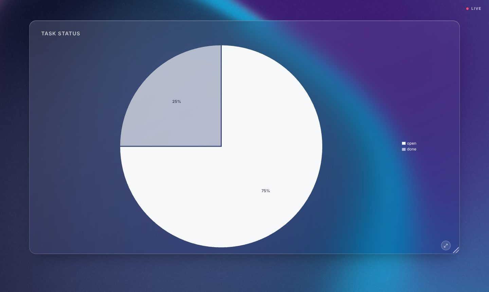

Every Live view has a URL, so a TV or a second monitor can show exactly one thing:

```
http://host:3210/?live=Dashboard&mode=auto
http://host:3210/?live=Dashboard&focus=chart:status&kiosk=1      # kiosk = no controls
```

### Phones

Live is responsive: on a phone it switches to the combined layout, one column, touch-friendly.


### Themes

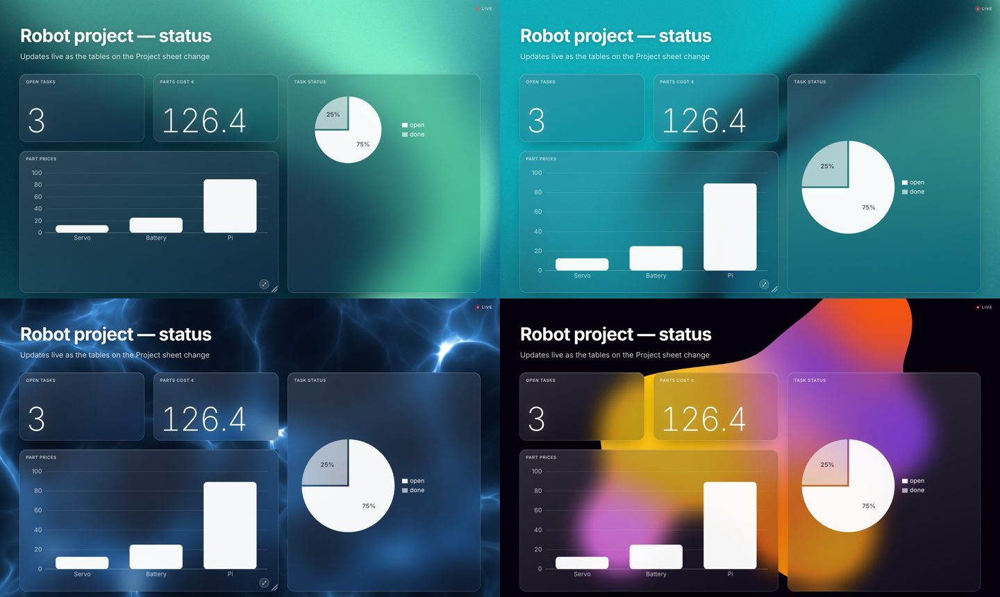

### The agent can drive Live

```bash
cm present Dashboard --combined          # put the user's screen into Live
cm present Dashboard chart:status        # focus one view
cm panel add brief "Agent summary" "**3 tasks open.**\n- Next: wire the servos"   # drop a card in, on the fly
cm slot logo --image /assets/logo.png --span 1 --h 160
cm live                                  # read back what the screen shows right now
```

`cm live` returns the visible cards with their positions and a one-line summary of each
(`● Dashboard::chart:status  pie "Task status"  @953,240 431×300  pie: open 3, done 1`), so the agent can reason about
the layout the user is looking at.

### Change effects

When the data behind the screen changes, the screen shows it (⟡ in the bar, stored in the workbook):

| effect | numbers | text | rows |
|---|---|---|---|
| **morph** (default) | KPIs count to the new value, digits roll | glyphs churn into the new word | new rows condense in, removed rows evaporate |
| **scramble** | glow, then the characters churn and lock in left to right | same | same |
| **vapor** | the old value drifts up and blurs away, the new one condenses | same | same |
| **glow** | the new value lights up and fades back | same | – |

Charts tween between values. Effects always end on the exact new text, respect *reduce motion*, and never touch the
cell you're typing in.

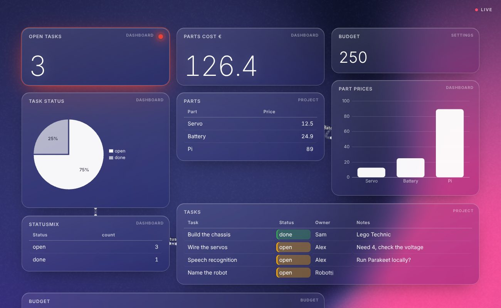

### KPI tiles

KPI cards size their number to the card, so a KPI can be a **small square tile** (drag it narrow, or
`cm chart kpi C12 --size small`) next to wide ones — the combined grid has half-width units. A KPI can also show
**two figures** (`--value2 C13 --label2 "cost"`: *3 open · 126 €*), in Live and in the grid.

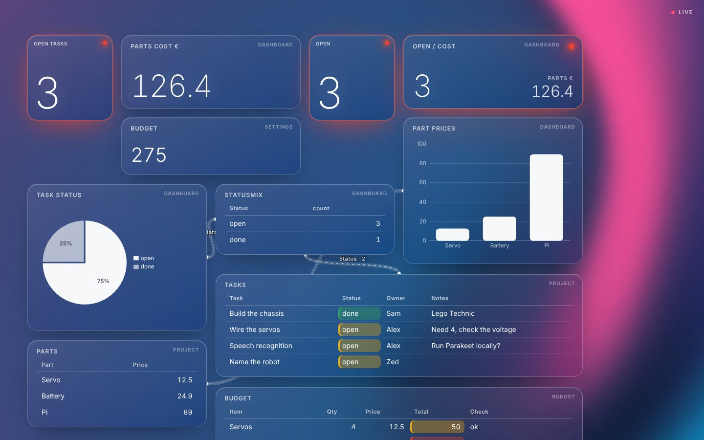

### Adaptive ink, flip, relations

- **Adaptive ink.** Live samples the background behind every card (shader or image) and switches that card to dark
  text and lighter glass when the background is bright. Charts repaint in a dark palette. Nothing to configure.
- **Slow machines**: Live measures its own frame rate. Without a GPU (VMs, remote desktops, TV sticks) it lowers the
  shader resolution step by step, then freezes the background to a still frame, and skips view transitions — so
  input never stalls. `cm live` reports the background quality.
- **Flip a card** (⟲) to see the sheet behind it: A1 addresses, raw formulas next to their values, and the card's
  recent change history (who changed what). Flip back to return.
- **Relations** (⛓, combined layout): Spread finds columns in different tables that share values, and which table feeds
  which chart, and draws them as animated lines between the cards, labelled with the joining column.

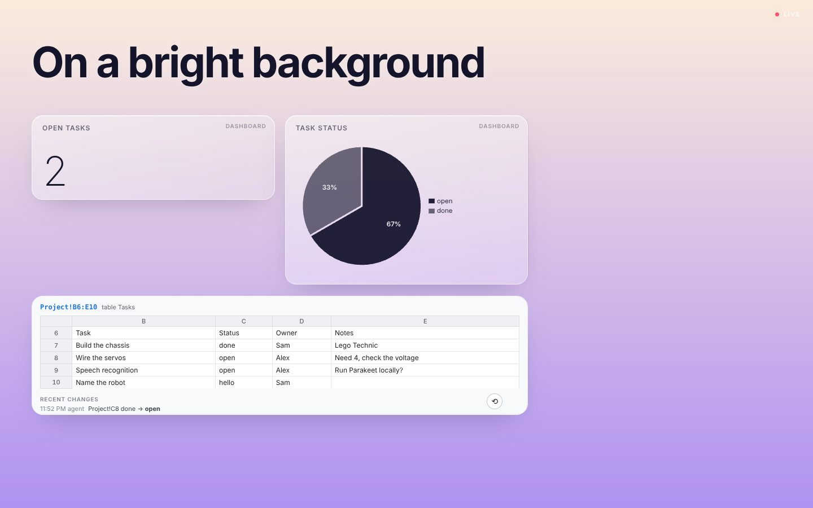

### Card looks

The Live bar has two pages: navigation (modes, sheets, slides) and **◐ Look ›** (theme, card look, table lines,
effects, font, flow). **▢** cycles cards between *glass* (frosted panel), *outline* (a thin frame, no blur) and
*clear* (no panel at all — the numbers float on the background, with a soft shadow for legibility). **☰** cycles
table lines: *rows*, *grid* (every cell boxed) or *none*. The agent can also set a look per card:

```bash
cm style cards clear          # workbook default
cm style lines none
cm style chart:cStatus card=glass    # this one keeps its glass
cm style chart:cStatus reset
```

### Maps

A table with coordinates becomes a **map card**: right-click a table → *🗺 Map of Places*, or
`cm map add Places --route`. Columns named `lat`/`lon` (also `latitude`, `lng`, `leveys`, `pituus`) or one `coords`
column (`60.17, 24.94`) are found by name. Each table is a layer; a layer can join its points into a **route**, color
them from a column (traffic lights, `#hex`, or one color per value) and draw an SVG visual at each point
(`=VIZ(…)` cells, or `pack` + `value`).

In Live the map is a real map (MapLibre GL, vendored): points **glide** when their coordinates change and leave a
fading trail, a click shows the point's row. In the grid the map is a sketch of the same points. Basemaps:

| `basemap` | | key? |
|---|---|---|
| `dark` (default) · `light` · `bright` | OpenFreeMap vector maps, OpenStreetMap data | no |
| `satellite` | Sentinel-2 cloudless 2023 imagery by EOX (10 m; CC BY-NC-SA 4.0) | no |
| `aerial` · `topo` · `fi` | Finland: orthophoto, topographic map, background map — National Land Survey (NLS), CC BY 4.0 | free NLS key |
| `none` | no basemap: the points float on the Live background (also the offline fallback) | — |

The Finnish maps go through Spread's server, which keeps the key and caches every tile:
`cm config nls-key YOUR_KEY` (get one free: [NLS API key](https://www.maanmittauslaitos.fi/en/rajapinnat/api-avaimen-ohje)).
The agent steers the camera:

```bash
cm map fly 60.17 24.94 --zoom 14 --pitch 45   # or: fly "Kamppi" · fly fit
cm map follow R2          # the camera follows a moving point (off to stop)
cm map focus Base         # highlight a point and show its row
cm map layer Parts --route · cm map layer Parts off · cm map basemap none
```

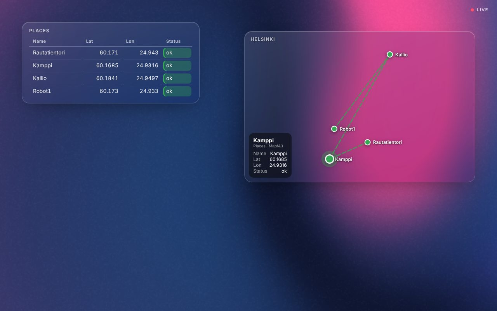

### Open data from Finland

Real-time public data polled straight into named tables — so it shows in the grid, on maps and in Live, the agent
reads it in its change feed, and every poll is a version you can **replay**:

| feed | source | table |
|---|---|---|
| `trains` | every running train in Finland, ~15 s (Fintraffic Digitraffic) | Train · Lat · Lon · Speed · Updated |
| `ships` | AIS vessel positions in an area, default off Helsinki (Digitraffic) | Ship · MMSI · Lat · Lon · Speed · Course · Updated |
| `roadweather` | road weather stations: air / road temperature, wind (Digitraffic) | Station · Lat · Lon · Air · Road · Wind |
| `weather` | latest observations by place (Finnish Meteorological Institute) | Place · Lat · Lon · Temp · Wind · Humidity · Updated |

```bash
cm feed add trains --map                 # table + map card; polls every 30 s
cm feed add ships --map --bbox 22,59.8,23.5,60.5 --every 60
cm feed add weather --places Helsinki,Tampere,Oulu
cm feed ls · cm feed run trains · cm feed pause trains · cm feed rm trains   (the table stays)
```

Each poll updates changed records, adds new ones and removes those that are gone (`--keep` keeps them). No keys
needed; all CC BY 4.0 — credit Fintraffic / digitraffic.fi and the Finnish Meteorological Institute.

### Time replay

**⏱ Replay** in the Live bar plays back what changed: the screen goes back to how the workbook looked at the start
(last 15 min, hour, today, since the last milestone, or any time) and every change since is replayed **sped up**
(×10 … ×3600) with the same effects as live — numbers roll, rows condense, map points drive their routes. A clock and
the date run in an overlay; quiet stretches are squeezed (⏩). Space pauses, ← → jump between changes, the timeline
scrubs, Esc returns to now. Nothing is written while you look at the past.

Every batch is stored with its exact inverse, so the past is rebuilt precisely (moves, inserts, restores included).

```bash
cm replay --from 09:00 --to 12:00 --speed 360 [--loop] [--screen tv]   # also -2h, v120, m3 (a milestone), ISO
cm replay ls --from -2h      # what changed in that window, as text
cm replay pause | play | next | prev | stop
```

The phone remote has ⏱ 15 min / 1 h / Today buttons; its ◀ ⏯ ▶ drive the replay while one runs.

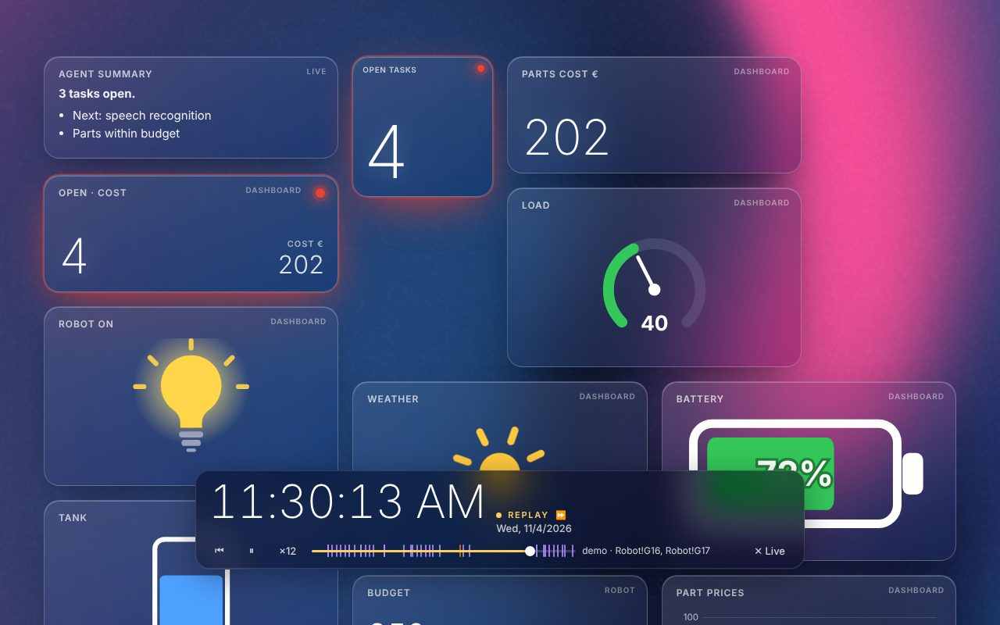

## Race weekend (Pitwall)

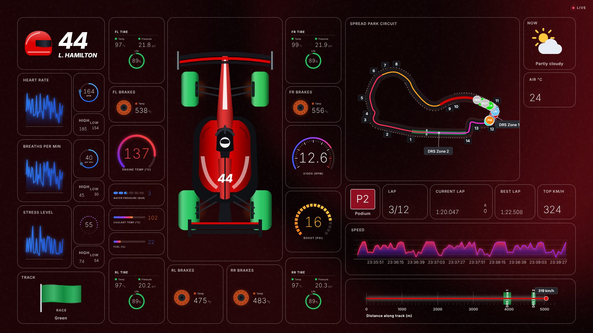

A telemetry dashboard built entirely from Spread's own parts, fed by a session simulator — and a template for any
"things moving along a line, one followed closely" tracking:

```bash
cm sim start race --laps 20 --speed 4       # or: practice --minutes 15 · qualifying; --focus HAM --seed 7
cm sim focus LEC                            # follow another car (the car, tyres, trail and vitals switch)
cm sim                                      # status: lap, flag, leader, seed
cm replay --from m12 --to m13 --speed 10    # every session starts and ends with a milestone
```

- **The simulator** (`lib/sim.js`) drives 22 cars round an original 5.3 km circuit: a speed profile from the corner
  radii and acceleration / braking limits, tyre wear, fuel, pit stops, the chequered flag; telemetry of the focus car
  (speed, RPM, temperatures, pressures, brakes, DRS), the driver's vitals and the weather. Seeded and deterministic.
  The 2026 grid's names are used; every number is simulated.
- **Every tick is one versioned batch** (≈ 9 kB), written into named tables on a `Data` sheet: `Cars`, `Tyres`,
  `Live` (key/value), `Circuit`, `Turns`, `Zones`, `LapTimes`, rolling `…Trace` tables. So the grid, Live, the change
  feed and **time replay** all work on a race exactly as on any workbook — replay a race, a practice, the moment of a
  pit stop.
- **The Pitwall** sheet is 34 ordinary cards anchored on one sheet: visual packs (`car`, `tyre-panel`, `brake`, `arc`,
  `dial`, `segments`, `pills`, `bar`, `vital`, `dots`, `driver`, `position`, `race-flag`), area charts with gradient
  traces over rolling windows, KPIs, and two **track cards**.

### Track cards

`type: "track"` draws any line from a table of `X, Y` (or `Lat, Lon`) points — a circuit, a bus line, a production
line, a running track — and puts the rows of other tables on it by **distance**: laps as a number (`16.42` = lap 16,
42 % round) or metres with `length`. Things glide forwards along the line between updates; `zones` (from–to), `marks`
(turn numbers, callouts), `sectors` color the line, and `trail` traces a glowing stretch behind one of them.
`layout: "line"` shows the same data as distance along the track, with zones as bands and a bubble.

```json
{"op":"addChart","type":"track","shape":{"table":"Circuit"},"layers":[{"table":"Cars","at":"Dist","label":"Code","color":"Color"}],
 "zones":{"table":"Zones"},"marks":{"table":"Turns"},"sectors":[0.33,0.67],"trail":"HAM","at":"K2"}
```

### Visuals with many values

A `multi` pack takes a range — `=VIZ("tyre-panel", B2:D2, "FL tire")`, or a card on `B2:J2` — with a color input
for liveries; any range pack takes its scale where it is used (`=VIZ("arc", A1, "°C", 60, 150)`); a card's label can
come from a cell (`"label": "=Data!C35"`). See [`VIZ_SPEC.md`](VIZ_SPEC.md).

## Slides

Any Live view can become a slide: a sheet or the combined layout, optionally focused on one card or filtered to a
few, with a title, text (light Markdown) and its own background. Then **▶ Play**: arrow keys / space / click, an
auto-advance timer per slide, a progress bar, Esc to leave.

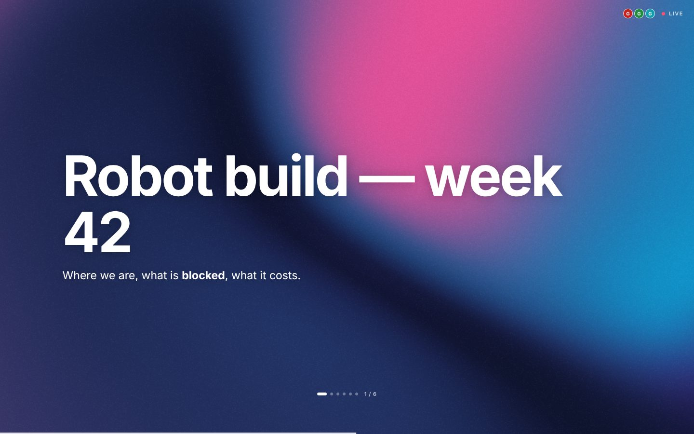

- **Backgrounds**: any shader theme, or an image. Plain images, **animated GIFs and animated SVGs** play as they are.
  Run an image through a shader with `filter: "dither"` or `"halftone"` (Paper Shaders' image filters, tinted with the
  slide's theme). Drop an image file onto a slide in the Slides panel to upload it.
- **Text-only slides**: `cards: []` gives a full-screen title slide.
- Slides are data in the workbook (`live.slides`), versioned and undoable like everything else, so the agent can
  build a deck:

```bash
cm slide add intro '{"title":"Robot build — week 42","text":"Where we are, what is **blocked**.","cards":[]}'
cm slide add costs '{"title":"Costs","sheet":"Dashboard","mode":"auto","cards":["kpiCost","parts"],"bg":{"image":"/assets/x.gif","filter":"dither"},"duration":8}'
cm slides                     # list
cm present --slide 1          # play it on the user's screen
```

Deep link: `/?slides=1` starts the show (add `&kiosk=1` for a wall screen).

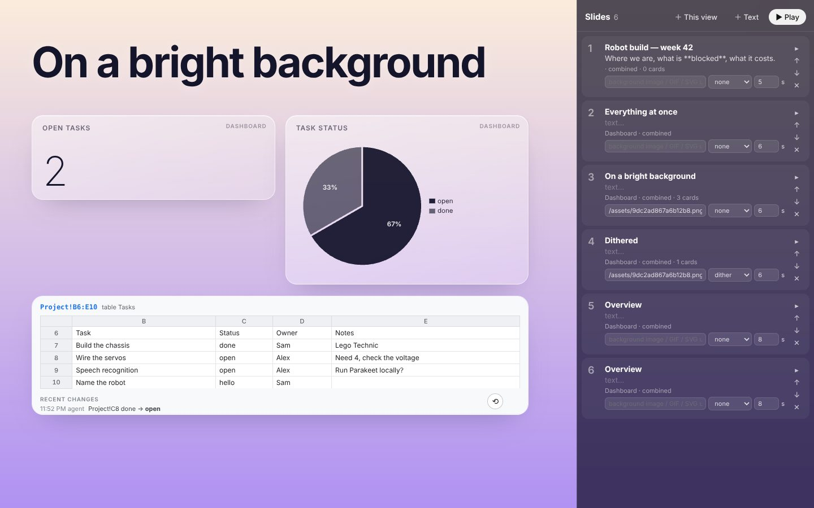
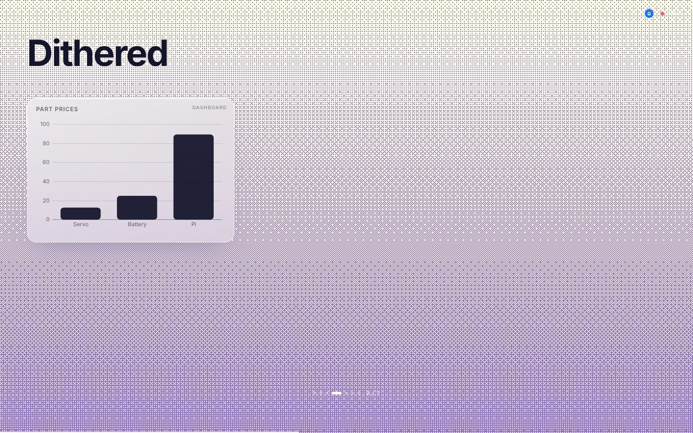

## Multi-user and history

- Open the same server in several browsers: everyone gets a name and color (click your avatar to change it). You see
  each other's **selection and active cell** with a name tag, colored dots on the sheet tabs they're on, and their
  edits **flash in their color** (agents flash purple). Live shows who's watching. All views update in real time —
  including a Live screen on a TV while someone edits the grid.
- `cm people` lists who is where (including who is in Live and on which slide).
- **History of a cell or a table**: right-click → *History of C8* / *History of table Tasks*. Cell history follows the
  cell back through moves and row/column inserts, so it survives cut/paste. Agents: `cm history Project!C8`,
  `cm history @Tasks`.
- Every batch is atomic: one undo reverts the whole batch, whether it was a paste, a SQL write-back or an agent edit.

## Remote control

Any open Live view is a **screen**. Open `/?screen=tv` on the TV (it goes straight to full-screen combined Live) and
`/remote` on your phone (📱 Remote in the top bar):

- **◀ ⏯ ▶** step through the slides — or, if there are none, through the cards as a **carousel** (each card
  full-screen in turn; ⏯ auto-advances). Swipe the buttons left/right. *Overview* goes back to everything.
- Tap a slide, a sheet, *Combined*, or any card on the screen to show it.
- **Edit data** from the phone: every table as a form (formulas shown, not editable), plus *Values* — the plain
  numbers behind KPIs. Fields offer the values a column already has. Edits are normal versioned edits, attributed
  to “… (remote)”, and the TV animates them.
- Several screens at once; pick one at the top. Agents too: `cm screens`, `cm present next --screen tv`.


Weak wall screen? `/?screen=tv&quality=low` (or `half`, `minimal`, `still`) starts the background at a lower
resolution; Live also steps down on its own when frames get slow.

## For agents

The full guide is [`AGENT_SKILL.md`](AGENT_SKILL.md) (also served at `GET /api/help`). The loop:

```bash
cm overview                 # docs, sheets, used ranges, tables, charts, the user's selection
cm changes                  # only what changed since your last call (your own edits filtered out)
cm read @Tasks              # read narrowly: a table as records, or a range
cm update Tasks 'Wire the servos' Status=done
```

What the change feed looks like:

```
v14 user 14:02:11 [main]
  Project!C8: open → done   ⟨Tasks[Wire the servos].Status⟩
  calc: Project!C12 3→2 · Dashboard!C28 3→2
v15 user 14:02:30 [main]
  MOVE Budget!A2:E5 → A8:E11 (20 cells; refs updated in Budget!D6)
```

- **Moves are structural events**, not 40 cell edits; formulas that pointed at the data were rewritten.
- `cm sel` tells the agent what the user has selected — so voice commands like *"add C23 and D32"* or *"sum these"* work.
- `expect` gives optimistic concurrency: `409` instead of overwriting a cell the user just changed.

## MCP server

`bin/mcp.mjs` exposes Spread to any MCP client over stdio (no dependencies; talks to the HTTP API at `CANVAS_URL`,
default `http://127.0.0.1:3210`):

```bash
claude mcp add spread -- node /path/to/spread/bin/mcp.mjs
```

Tools: `spread_help`, `spread_overview`, `spread_changes` (keeps its own cursor, own edits filtered out),
`spread_read`, `spread_ops`, `spread_sql`, `spread_history`, `spread_live`, `spread_screens`, `spread_present`,
`spread_map`, `spread_replay`, `spread_feed`, `spread_sim`, `spread_viz`, `spread_demo`.

## Guided demo

A 25-step tour of the features, on its own workbook (`/#demo`; yours is untouched). Open the app, then:

```bash
cm demo               # Enter = next step, b = back, r = repeat, 7 = jump, q = quit
cm demo --auto 7      # hands-free, 7 s per step
cm demo --list        # the steps
cm demo --step 13     # one step (card looks)
```

An agent runs the same tour over MCP (`spread_demo`, step by step, telling you what to watch) or the CLI.
[`FEATURES.md`](FEATURES.md) lists every feature with how to try it and which demo step shows it — a checklist for
manual testing.

## Versioning

- Every batch is a version (`data/log.jsonl`). The **History** panel shows the same text the agent reads; cell
  addresses are links.
- **Milestones** (Ctrl+S, or `cm commit`) are named snapshots. **Diff** highlights changed cells in the grid and is
  move-aware — data that was moved doesn't show up as deleted + added. **Restore** reverts.
- Undo/redo uses exact inverses for every op, including moves, row/column deletes, merges, tables and charts —
  verified by a 2000-round randomized test.

## Architecture

```
public/shared/                ← the same code runs in the browser AND on the server
  a1.js                         addresses
  formula.js                    tokenizer, Pratt parser, reference rewriting (no eval)
  engine.js                     lazy memoized evaluation, ~50 functions, IMAGE()
  types/sheet.js                workbook state + ops: apply(state, op) → { inverse, changes }
  types/text.js                 a second canvas type (proves the plugin shape)
  export.js                     sheet → Markdown / HTML document
  fonts.js                      font stacks
public/canvases/sheet/
  view.js                       the grid
  charts.js                     native canvas charts (light + glass themes)
  live.js                       Live mode: shaders, glass cards, combined layout, focus, drag
public/vendor/paper-shaders/  Paper Shaders (Apache-2.0), TypeScript types stripped with node:module
public/app.js                 shell: canvases, live sync (SSE), history, milestones, SQL panel
lib/store.js                  versioned op log, atomic batches, recalculation diffs, milestones
lib/sql.js                    tables ⇄ node:sqlite, write-back as table ops
lib/format.js                 token-cheap text renderings for agents
bin/cm.mjs                    the agent CLI
lib/studio/                   coding agents: acp.js (ACP client) · index.js (boxes, worktrees, gates, fork, review)
                              shadow.js (snapshots) · monitors.js · db.js (sessions as SQL)
public/canvases/studio/       the studio canvas (semantic zoom, diff tray, timeline, spotlight)
bin/mock-acp.mjs              a deterministic ACP agent for demos and tests
server.js                     node:http — REST, SSE, static files
```

The browser applies the same `apply()` optimistically, so the UI is instant and the server stays the source of truth.
Change records come from the ops themselves, which is why the feed is semantic (a move is a move).

**Adding a canvas type** (kanban, whiteboard, …): write `shared/types/<name>.js` (`create, apply, diff, describe, read`),
register it in `types/index.js`, and add `canvases/<name>/view.js` (`mount(root, ctx) → { remote, reload, unmount }`).
Versioning, milestones, the change feed, live sync and the agent API come for free.

## API reference

Text responses by default; add `format=json` for JSON.

| Endpoint | |
|---|---|
| `GET /api/overview` | docs, sheets, used ranges, tables, charts, selection |
| `GET /api/changes?since=N[&exclude=agent][&mode=net]` | change feed; last line is `cursor: N` |
| `GET /api/read?range=Sheet!A1:F20` · `range=@Table` | cells, or a table as records |
| `POST /api/ops` | `{ doc?, by, ops: […], expect? }` — atomic batch |
| `POST /api/sql` | `{ sql, write?, into?: { name, at } }` |
| `GET /api/table?name=` · `PUT /api/table` | table ⇄ JSON |
| `GET /api/chart?id=` | a chart's live data |
| `GET /api/export?sheet=&format=md\|html\|json` | sheet as a document |
| `POST /api/assets` | raw image body → `{ url }` |
| `POST /api/commit` · `GET /api/commits` · `GET /api/diff?from=m3` · `POST /api/restore` | milestones |
| `GET /api/selection` · `POST /api/focus` | the user's selection · highlight where the agent works |
| `POST /api/present` · `GET /api/live?screen=` | drive Live (`{sheet, mode, focus, slide, action: next\|prev\|play\|pause\|toggle\|unfocus, replay: {from, to?, speed?, loop?, gaps?} \| "stop", screen}`) / read what a screen shows |
| `GET /api/feeds[?kinds]` · `POST /api/feeds` · `POST /api/feeds/run` · `POST /api/feeds/set` · `DELETE /api/feeds?id=` | open data feeds into tables |
| `GET /api/config` · `POST /api/config` · `GET /tiles/nls/<layer>/<z>/<x>/<y>` | server settings (NLS key) · cached Finnish map tiles |
| `GET /api/sim` · `POST /api/sim` | session simulator: `{action: start\|stop\|focus, session, laps, minutes, speed, focus, seed}` |
| `GET /api/replay?from=&to=` | the doc as it was at `from` and every batch up to `to` (text summary, or `format=json`) |
| `GET /api/screens` | open Live views (TVs, laptops) and what they show |
| `GET /api/viz` · `GET /api/viz/spec` · `POST /api/viz[?dry=1]` · `DELETE /api/viz?id=` | SVG visual packs: list, the spec, validate / install, remove |
| `GET /api/history?cell=Sheet!C8` · `?table=Tasks` | change history of a cell (move-aware) or a table |
| `GET /api/presence` · `POST /api/presence` | who is here, where, and in Live |
| `GET /api/events` | SSE stream of every change and presence update |

Configuration: `PORT`, `HOST` (default `127.0.0.1` — there is no authentication), `CANVAS_DATA` (data directory),
`CANVAS_URL` for the CLI.

## Roadmap

- **Grafana dashboard import** — read a Grafana dashboard JSON (panels, grid positions, titles, thresholds) and map it
  onto Live cards and charts. Grafana is AGPL-3.0, so this will be an importer of its JSON format, not a port of its code.
- **Network graphs** — nodes and edges from two tables (e.g. agents and their messages) as a force layout card.
- More chart types (scatter, heatmap, sparkline columns in tables); color scales next to traffic lights.
- Authentication for anything beyond a trusted LAN.

## Credits

Background shaders: [Paper Shaders](https://github.com/paper-design/shaders) by Paper, Apache-2.0
(vendored unmodified apart from type stripping; see `public/vendor/paper-shaders/`).

Maps: [MapLibre GL JS](https://github.com/maplibre/maplibre-gl-js), BSD-3-Clause (vendored unmodified, loaded only when a
map is shown; see `public/vendor/maplibre/`). Tiles from [OpenFreeMap](https://openfreemap.org), map data ©
[OpenStreetMap](https://www.openstreetmap.org/copyright) contributors; imagery: Sentinel-2 cloudless by EOX (contains
modified Copernicus Sentinel data); Finnish maps © Maanmittauslaitos (CC BY 4.0). Feeds: Fintraffic / digitraffic.fi and
the Finnish Meteorological Institute, CC BY 4.0. Attribution is shown on every map.

## License

MIT
