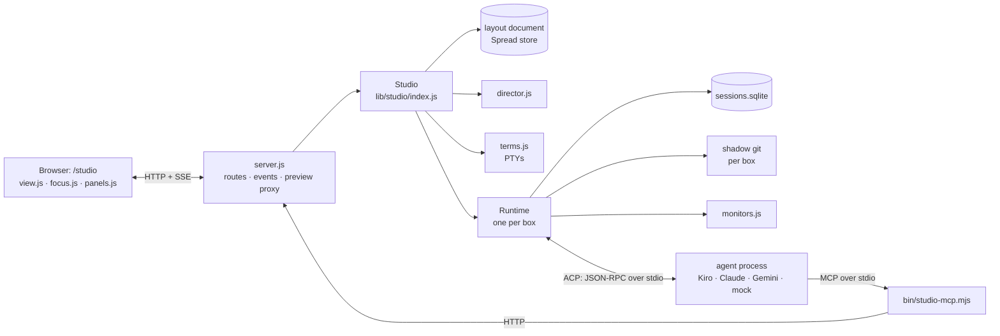
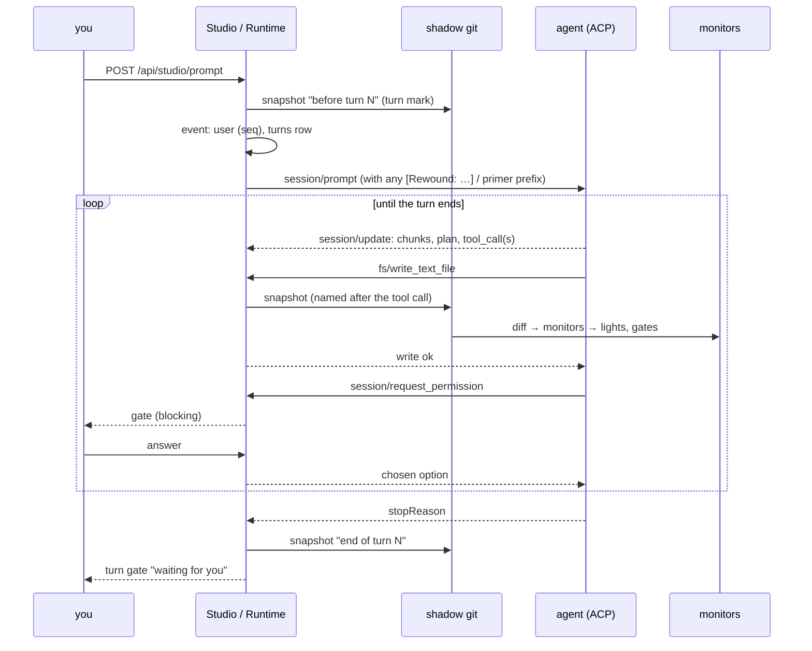

# Architecture

One Node process, no npm dependencies. The browser is only a view: everything runs on the server, with or without a screen.



## Modules

```
server.js                 HTTP routes, SSE, static files, the preview proxy, token auth
lib/store.js              Spread's document store: versioned docs, batches of ops with inverses, history, events
lib/studio/
  index.js                Studio: boxes, worktrees (sparse), presets, fork / spawn / review / view / say;
                          Runtime (one per box): the ACP session, prompt queue, permissions, snapshots,
                          monitors, turns, rewind
  acp.js                  ACP client: spawn, JSON-RPC lines, initialize, session/new|load|prompt|cancel, fs requests
  db.js                   SessionDB: agents, events, turns, snapshots, monitors, gates (node:sqlite)
  shadow.js               Shadow: a bare git repository per box with its own index; snapshot, diff, show, restore, materialize
  monitors.js             the built-in monitors and command monitors
  director.js             the director: rules, quiet period, digests for a director agent
  terms.js                terminals: a PTY per panel through bin/pty-bridge.py, scrollback
  preview.js              /preview/<port>/ reverse proxy, HTTP and WebSocket upgrade
public/shared/types/studio.js   the layout document type: agents, panels (with float), layouts, config; ops and inverses
public/canvases/studio/
  view.js                 the canvas: boxes, panels, gates, changes tray, timeline, spotlight, keys
  focus.js                focus mode (agents, session + composer, tabs) and floating panels
  panels.js               terminal, preview and code-map panel bodies
  term.js                 a VT100/xterm-style terminal emulator
  layout.js               arrangements and saved layouts
  saver.js                idle mode: the paper shader and the ticker
  studio.css              light and dark themes, all components
bin/
  mock-acp.mjs            a deterministic ACP agent
  studio-mcp.mjs          the studio's tools for agents (MCP server over stdio)
  pty-bridge.py           PTY for terminals (python3, no native modules)
  remote.mjs              start on a remote machine and tunnel to it
```

## Two kinds of state

| | where | how it changes | who sees it |
|---|---|---|---|
| **Layout**: boxes, panels, positions, floats, saved layouts, the director setting | a Spread document of type `studio` | batches of ops, each with its inverse (undo, history) | every screen, through `batch` events |
| **What agents do**: events, turns, snapshots, monitors, gates | `sessions.sqlite` and the shadow repositories | appended by the runtimes | every screen, through `studio` events |

The screen state that is not shared (camera, mode, selected agent, text size, tray height) is kept in the browser's `localStorage`.

## What happens on a prompt



Every step is also an event on `/api/events`, which is how the screens, subtitles, the dashboard twin and the director follow along.

## Snapshots without touching your git

`shadow.js` keeps a bare repository per box under `data/studio/shadow/` and runs git with `--git-dir` pointing there, `--work-tree` at the box's folder and a private index file. A snapshot is `add -A` → `write-tree` → `commit-tree` → `update-ref`. Restoring removes the files that did not exist in the target snapshot, then writes its files back (*materialize*, through a temporary index). Forks *materialize* a snapshot into a new worktree. Snapshots are serialized per box, so every one belongs to exactly one tool call.

## Rewinding a conversation

ACP has no call to cut an agent's history. A conversation rewind therefore makes a new ACP session (`session/new`) on the running agent process, and the next prompt is prefixed with the turns before the rewind point as text, plus a `[Rewound: …]` note. The rewind is an event in the log (`kind: rewind`, `json.cut` = the first rewound event), so transcripts sent to agents later skip the rewound range, and the screen greys it out.

## The dashboard twin

The studio mirrors its boxes and monitor lights into an ordinary Spread sheet (`<doc>-dash`, tables *Agents* and *Monitors*), so Spread's Live dashboards, SQL over tables and time replay work on the agents too. ⌘K → *Agents dashboard*.
