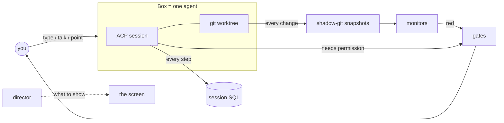

# Concepts

Evenflow is built from a few ideas. Once you know them, the screen explains itself.

## Box

A **box** is one coding agent: an [ACP](https://agentclientprotocol.com) session with its own process, its own working directory and, by default, its own git **worktree** on its own branch (`studio/<name>-xxxx`). Agents in different boxes cannot step on each other's files.

A box can instead share a folder with another box (a *reviewer in the same folder* sees the other's uncommitted work), or get a **sparse checkout**: only the paths you name in a monorepo.

On the canvas a box is a rectangle that shows the session: plan, transcript, tool calls, permission prompts, the files it changed, its monitors and its snapshots. In focus mode the same box fills the middle of the screen.

## Session and events

Everything that happens in a session is an **event** in a SQLite database: your prompt, the agent's messages and thoughts, every tool call and its result, plans, permission questions and answers, turn ends, rewinds, errors. The transcript you see, the timeline, replay and `POST /api/studio/sql` all read the same tables.

A restarted agent resumes its ACP session (`session/load`) when it can. Otherwise it gets the conversation so far as text.

## Turn

A **turn** is one prompt and everything the agent does until it stops. When a turn starts, Evenflow snapshots the worktree and records where the turn's prompt is in the event log. Every turn is therefore a point you can go back to: the conversation, the files, or both. See [History](history.md).

## Snapshot

After every tool call and file write, the box's working directory is committed into a private **shadow git**: a separate repository per box, outside your project. Your repository's own git, index and branches are never touched. Writes that go through ACP's `fs/write_text_file` are snapshotted before the agent hears back, so each snapshot belongs to exactly one tool call and is named after it (`Write src/greeting.js`).

Snapshots are the timeline: every diff of every agent, in order. You can scrub it, replay it, rewind a box to any snapshot, or fork a new box from one.

## Monitor

A **monitor** is a deterministic check that runs on every snapshot, with no model involved: does the code still parse, is the agent rewriting the same lines in circles, did a test disappear, did a secret appear, did dependencies change, did it touch files outside its scope. You can add your own (`npm test`, a type checker). Each has a light: green, amber or red. See [Monitors and gates](monitors.md).

## Gate

A **gate** is a place where an agent needs you: a permission question (it blocks the agent until answered), a monitor that went red, a finished turn waiting for your reply, a crashed agent, an agent that spun off a copy of itself. Gates are listed in one place, and `G` jumps to the next.

## Panel

Everything on the screen that is not an agent is a **panel**: a note, a snippet, a saved prompt, a review, an SQL result, a real terminal, a live preview of a running app, a code map. A panel can belong to a box (a terminal in its worktree, a review of its changes) or to the project. Any panel can **float**: pinned on top of the screen in both modes.

## Layout document

Where boxes and panels are, their sizes, saved layouts and settings form a versioned **document** (a Spread document of type `studio`). Every move is an operation that can be undone, every screen showing the studio sees the same thing, and it all exists on the server whether or not a browser is open. Evenflow runs **headless**: agents, previews and terminals keep going without a screen.

## Two ways to look at it

- **Canvas mode**: every box and panel on an infinite canvas. Zoom out and boxes become tiles (name, status, red lights, their last sentence); zoom in and you see the whole session. Good for many agents at once.
- **Focus mode** (`⌘\`): a classic coding layout around one agent. The agents are on the left, its session and a composer in the middle, and its changes, terminals and previews as tabs on the right. Good for working with one agent for a long time.

They show the same boxes and panels; switching just moves them. See [Using Evenflow](guide.md).

## Director

The **director** decides what the screen shows. *Off*: you do. *Rules*: deterministic rules bring a permission question, a red monitor or a new dev server into view. *Agent*: a director agent gets a digest of what happened and moves things with its tools. Every move shows its reason, and while you are using the studio the director only reports. See [The director](director.md).

## The agents' own tools

Every agent gets the studio's tools over MCP. It can spin off a copy of itself to try an alternative (the reason is shown to you), start a reviewer, open a preview of what it built, a terminal or a code map, change what the screen shows, leave a note, or message another agent. See [Agents](agents.md#the-agents-own-tools-mcp).

## Glossary

| | |
|---|---|
| **ACP** | Agent Client Protocol: JSON-RPC over stdio between an editor (here: Evenflow) and a coding agent |
| **box** | one agent: ACP session + working directory |
| **worktree** | a git worktree on its own branch, one per box by default |
| **sparse checkout** | a worktree with only some paths of a monorepo |
| **shadow git** | a box's private snapshot repository, separate from your project's git |
| **snapshot** | the box's working directory after a tool call (or at the start of a turn), numbered `#0` (base), `#1`, … |
| **turn** | one prompt and the agent's work on it |
| **rewind** | going back to before a turn (conversation, files or both) or to a snapshot (files) |
| **fork** | a new box from a snapshot: its files then, and the conversation up to it |
| **spawn** | a sub-agent: a reviewer in the same folder, or a helper in its own worktree |
| **monitor** | a deterministic check on each snapshot, with a green / amber / red light |
| **gate** | a place where an agent needs you |
| **panel** | a note, snippet, prompt, review, SQL result, terminal, preview or code map |
| **float** | a panel pinned on top of the screen |
| **director** | what decides what the screen shows |
| **view command** | an instruction to every screen: focus this, open that, switch mode, float, move (`POST /api/studio/view`) |
