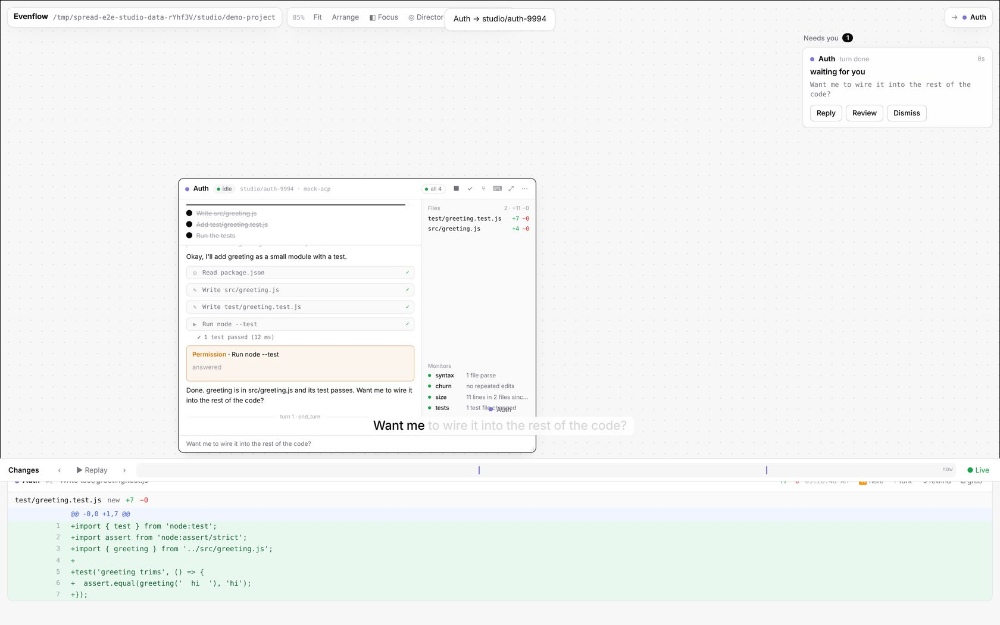
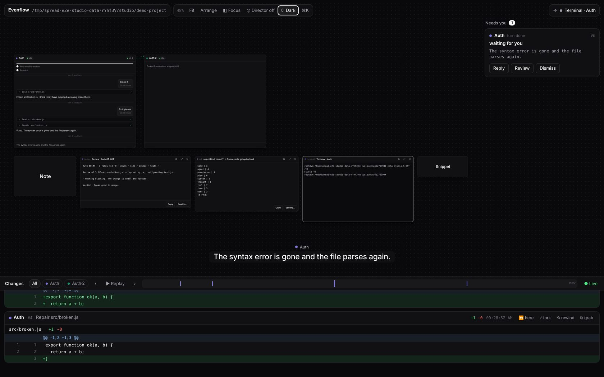
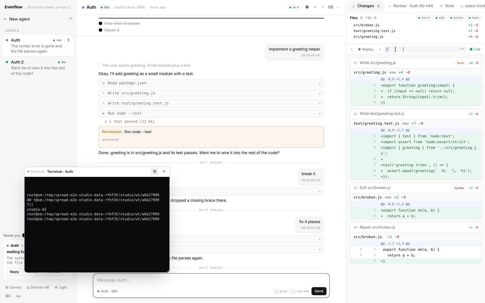
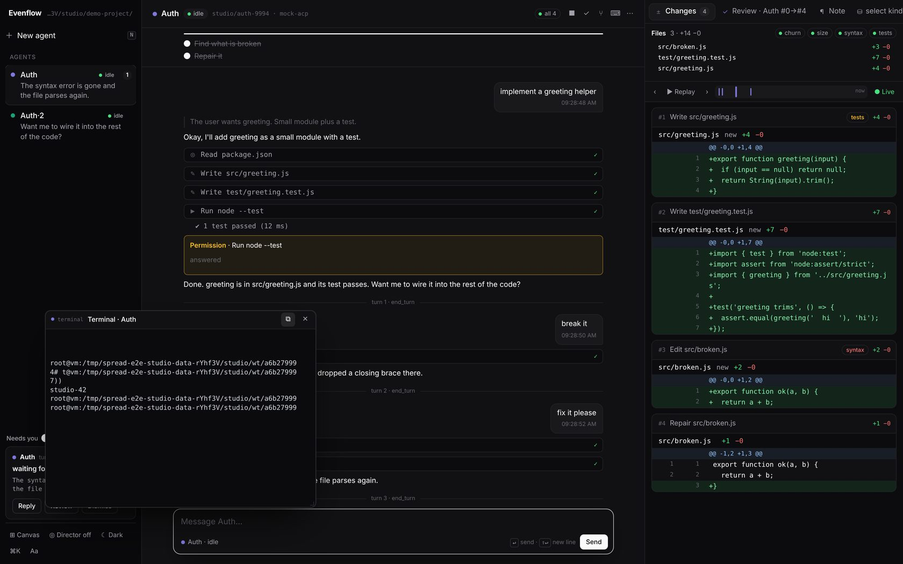
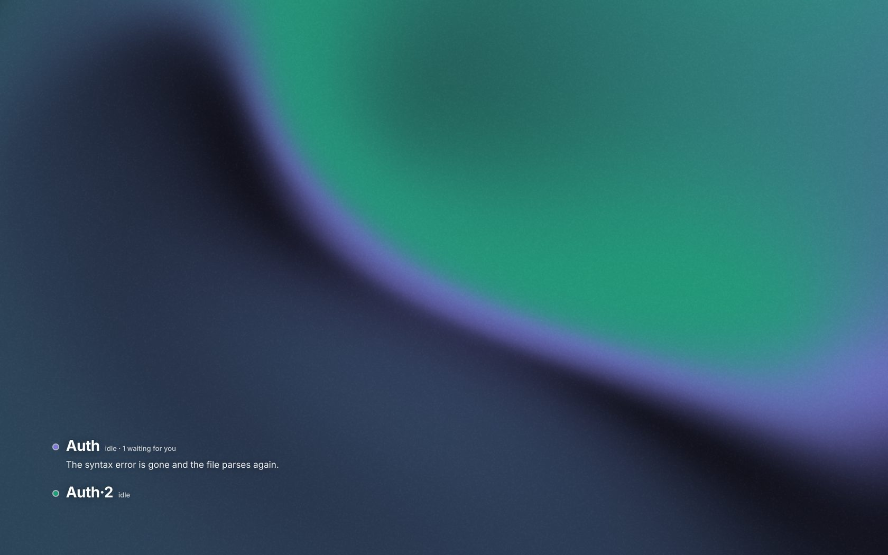

# Using Evenflow

The studio has two modes over the same boxes and panels: **canvas** for many agents at once, and **focus** for working with one. `⌘\` (Ctrl+\\) switches between them, and the toolbar has ◧ *Focus*. The mode is remembered per browser.

## Canvas mode

- **New agent**: `Shift`+drag a rectangle (or `N`, then drag), pick an agent, optionally a name, a first task and sparse paths. The box appears where you drew it.
- **Talk by pointing**: whatever is under the pointer is the target, and the chip at the top right shows it. Start typing over a box and a floating input opens aimed at it; `↵` sends (queued if the agent is busy), `⇧↵` adds a new line, `Tab` moves to the next box. Typing over a note writes into it, and typing over a terminal types into the shell.
- **Semantic zoom**: far away a box is a tile (name, status, red lights, its last sentence); closer it is a card; close up it is the whole session. Double-click a box's header or press `⌥Z` to zoom to it, and `Esc` to fit everything. Drag the background or scroll to pan; pinch or `⌘`+scroll to zoom.
- **Move and resize**: drag a box by its header and resize it from the corner. Every move goes into the layout document and can be undone.
- **Gates**: the column on the right lists where agents need you. `G` jumps to the next one, and `Y` / `A` / `N` answer the permission of the box you point at.
- **Changes tray**: the bottom of the screen, `B` to show or hide it. Every snapshot of every agent is a diff card on one timeline (see [History](history.md)).
- **Subtitles**: what agents say streams at the bottom as subtitles. The box you point at wins.

## Focus mode

A classic coding layout around one agent:

- **Left**: the agents, each with its status, what it last said, how many gates are open and a red dot if a monitor is red. Click one to switch, or use `↑` `↓`. *New agent* opens the picker. Dropping a prompt bubble or a snippet onto an agent sends it there. Below the list are the gates, and at the bottom are the mode, director, theme, ⌘K and text size controls.
- **Middle**: the agent's session (plan, transcript, tool calls) with a **composer** under it. `↵` sends, `⇧↵` adds a new line, and `↑` in an empty composer recalls the last prompt. While the agent works, *Stop* interrupts it and new messages are queued. A permission question appears right above the composer with its buttons.
- **Right**: tabs. **Changes** shows the files the agent changed, its monitor lights and every diff with the timeline, replay, rewind and fork. Then come the agent's own panels (terminals, previews, code maps, reviews, notes), then the project's panels. **＋** opens a terminal in the agent's worktree, a preview, a code map, a note or a review. Drag the divider to resize the pane.
- **Typing**: letters always go to the composer, so the single-letter shortcuts of the canvas are off. ⌘K has every command.
- **Text size**: `⌘+` / `⌘−` / `⌘0`, or *Aa* in the sidebar. On the canvas the same keys zoom the camera.

Nothing is copied between the modes: the box and its panels are moved into place. Terminals keep running and the transcript keeps streaming; previews reload once.

## Floating panels

⧉ on any panel (or on its tab in focus mode) **floats** it: the panel is pinned on top of the screen and stays there in both modes. Use it for a preview of the app while you talk to the agent, or a terminal next to the diffs. Drag it by its header and resize it from the corner. Its position is stored as a fraction of the screen, so it lands in the same place on a laptop and on a 32" monitor. ⧉ again puts it back on the canvas, or into its tab.

## Panels

| | How | |
|---|---|---|
| **Note** | `T` or double-click the canvas; *Note* in focus mode's ＋ | Text you write. Drag it onto a box (or *Send to…*) to send it as a prompt |
| **Snippet** | Select text anywhere (a transcript, a diff) and press `S`, or drag the text onto the canvas | Code or text grabbed for later. Dropped onto a box, it is sent to the agent |
| **Prompt** | Drag a prompt bubble from a transcript onto the canvas | Run the same prompt in another box by dragging it there |
| **Review** | `⌥R`, ✓ on a box, *Review* on a turn gate | A read-only reviewer session writes its findings about the diff (up to the scrub point) and the monitor results. *Send to…* hands them back |
| **SQL** | ⌘K, then type `select …` | A read-only query on the session database, as a table |
| **Terminal** | `⌥T`, ⌨ on a box | A real shell (PTY) in the box's worktree, or the project root. Late viewers get the scrollback |
| **Preview** | ⌘K and a URL or a port; *Preview a running UI…*; an agent's `studio_show` | A running app (`http://localhost:5173`), a dashboard, a [voxl](https://github.com/tembo/voxl) desktop. Local URLs go through the studio server, WebSockets included, so a remote studio shows the remote machine's apps. Hover to interact, ⌖ keeps it interactive |
| **Code map** | `⌥M` | A treemap of the repository (or of a box's latest snapshot, or a sparse slice); every file an agent touched takes its color. Click a file to open its latest diff |

## Agents together

- **Fork** (`⌥F`, ⑂ on a diff card): a new box from a snapshot, with its own worktree, the files of that moment and the conversation up to it. A dashed link shows where it came from.
- **Reviewer in the same folder** (⋯ on a box): a sub-agent that sees the box's uncommitted work, with no new branch.
- **Sub-agent in its own worktree** (⋯): a copy of the box's current files and a fresh conversation, with a task you give it.
- **Agents do it themselves**: an agent can spin off a copy of itself to try an alternative, with the reason shown on the new box and as an update in the gates, or start a reviewer. See [Agents](agents.md#the-agents-own-tools-mcp).

## Layouts and looks

- **Arrange** (`L`): grid, one row, forks as a tree, around the pointed box, or tiles. Panels that belong to a box move with it. *Save this layout…* keeps named layouts to switch between.
- **Light and dark**: follows the system, or ◐ in the toolbar.
- **Idle**: when nobody touches the studio for a minute (⌘K → *Screensaver after…* to change it or turn it off), the panels fade out one by one and a paper shader stays, colored by the agents and moving faster the more of them are working, with each agent's name and last sentence on top. Any input brings everything back.

## Spotlight

`⌘K` / `Ctrl+K`: every command by name. That includes new agents, go to / focus on / review / fork / stop any box, terminals, code maps, layouts, the director, replay, themes, the screensaver, focus mode and floating panels. Type a URL or a port to preview it, or `select …` to query the session database.

## Keys

### Everywhere

| | |
|---|---|
| `⌘K` | spotlight: every command |
| `⌘\` | canvas ⇄ focus mode |
| `⌥R` `⌥F` `⌥T` `⌥M` | review · fork · terminal · code map for the box you point at (focus mode: the selected agent) |
| `⌥S` `⌥.` `⌥D` | start / stop · interrupt · only its diffs |
| `[` `]` | previous / next snapshot |
| `Esc` | close · back to live (canvas: then fit everything) |
| select + `S` | grab the selection as a snippet |
| `?` | the keys of the current mode |

### Canvas

| | | | |
|---|---|---|---|
| `Shift`+drag · `N` | new agent box | `G` | next gate |
| point + type · `↵` · `/` | the floating input, aimed at what you point at | `P` | replay every change |
| `T` · double-click | new note | `L` · `D` | arrange · director |
| `Y` `A` `N` | answer the permission of the box you point at | `B` | show / hide the changes tray |
| `⌥Z` | zoom to the box | `⌘0` `⌘+` `⌘−` | fit · zoom in · zoom out |
| drag · scroll | pan | pinch · `⌘`+scroll | zoom |

### Focus mode

| | |
|---|---|
| typing | goes to the composer |
| `↵` · `⇧↵` · `↑` | send · new line · recall the last prompt |
| `↑` `↓` | previous / next agent (when not typing) |
| `Y` `N` | answer the permission (when not typing) |
| `⌘+` `⌘−` `⌘0` | text size |
