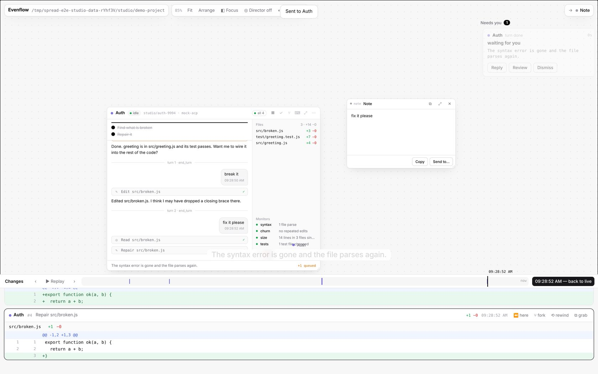
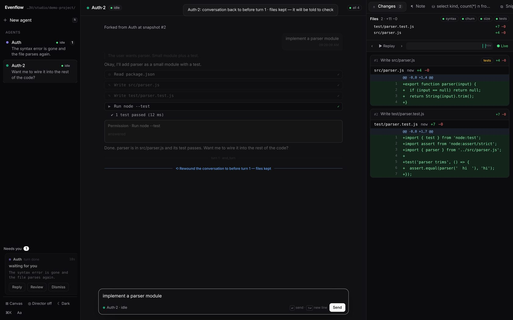

# History: snapshots, rewind, fork

Every change an agent makes can be seen, replayed, undone or branched from. None of it touches your repository's own git.

## What is recorded

| | When | Where |
|---|---|---|
| **Events** | every prompt, message, thought, tool call, plan, permission, turn end, rewind | `events` in `data/studio/sessions.sqlite` |
| **Snapshots** | after every tool call and file write, and when every turn starts | the box's shadow git, `data/studio/shadow/<agent>.git`; listed in `snapshots` |
| **Turns** | when a turn starts: its prompt event and the snapshot just before it | `turns` |
| **Monitor results** | for every snapshot | `monitors` |

A snapshot is a commit of the box's whole working directory: `git add -A` into a separate index and repository, so the project's index is never touched. `.gitignore` is honoured, and `node_modules`, `dist`, `target`, `.venv`, `.next` and `__pycache__` are always skipped. When nothing changed since the last snapshot, no new one is made; a turn then points at the latest one.

## The timeline

The changes tray (canvas: the bottom, `B`; focus mode: the **Changes** tab) shows every snapshot of every agent as a diff card, in time order. Quiet stretches are squeezed so the bar stays readable. Filter by agent with the chips (focus mode always shows the selected agent).

- **Scrub**: drag on the bar, or press `[` `]`. The whole studio shows that moment: each box's transcript, files and monitor lights as they were. *Back to live* or `Esc` returns.
- **Replay** (`P`, ▶): steps through every change from the scrub point (or the beginning), about one a second, then returns to live.
- **⏪ here** on a card: jump to that moment.
- **⧉ grab**: the card's diff as a snippet panel.

## Rewind a turn

⟲ next to any prompt in a transcript (hover over the prompt) offers:

| | The conversation | The files | The agent is told, at the start of your next message |
|---|---|---|---|
| **Rewind the conversation — keep the files** | back to before this prompt | stay as they are now | *[Rewound: your conversation was rewound to just before turn N, but the files were kept — the project has moved on since that point. Check the current state of the working directory (git status, git diff, re-read the files you need) before you continue.]* |
| **Rewind the conversation and the files** | back to before this prompt | back to the snapshot taken when that turn started | *[Rewound: your conversation and the working directory were rewound to just before turn N. The files are exactly as they were then; re-read them before editing.]* |
| **Rewind the files only** | carries on | back to the snapshot taken when that turn started | *[Rewound: the user put your working directory back to how it was when turn N started. …]* |
| **Fork a new box from here instead** | a new box with the conversation up to here | the files of that moment, in a new worktree | — |

How the conversation goes back: ACP has no way to cut an agent's own history, so the box gets a **fresh ACP session** whose first prompt carries the turns before the rewind point as text (the same mechanism forks use). The agent process keeps running. The note in the table above is put in front of the next message you send, whenever that is, and survives a server restart.

The prompt you rewound comes back into the composer (focus mode) or the floating input (canvas) so you can edit and resend it.

**Nothing is deleted.** Rewound turns stay in the transcript, greyed, after a ⟲ divider, and they are left out of anything later sent to an agent (forks, restarts, further rewinds). Before files are rewound, the current state is snapshotted, so a rewind can itself be rewound.

The API: `POST /api/studio/rewind {agent, turn, mode: "conversation" | "both" | "files"}`, and `GET /api/studio/turns?agent=` for the turns.

## Rewind to a snapshot

⟲ *rewind* on a diff card puts that box's working directory back to that snapshot; the conversation carries on. The agent's next message starts with the same kind of *[Rewound: …]* note. The state before is snapshotted first. `POST /api/studio/rewind {agent, snap}`.

A rewind is refused while the agent is working; stop or interrupt it first (`⌥.`).

## Fork

⑂ *fork* on a diff card (or `⌥F` on a box, which uses the scrub point) makes a **new box**:

- a new worktree and branch, with the files exactly as they were at that snapshot;
- the conversation up to that moment, given to the new session as context;
- a dashed link on the canvas from the parent (`⑂ #3`).

Give it a different task and the two branches go their own ways. Agents can fork themselves with `studio_fork`, and must give a reason, which is shown on the new box.

## What is never touched

Your repository's checkout, index, branches and stashes. Agents work in worktrees on `studio/…` branches (unless a box was created with `worktree: false`, or shares a folder), and snapshots live in separate repositories. Merging an agent's work is up to you.
